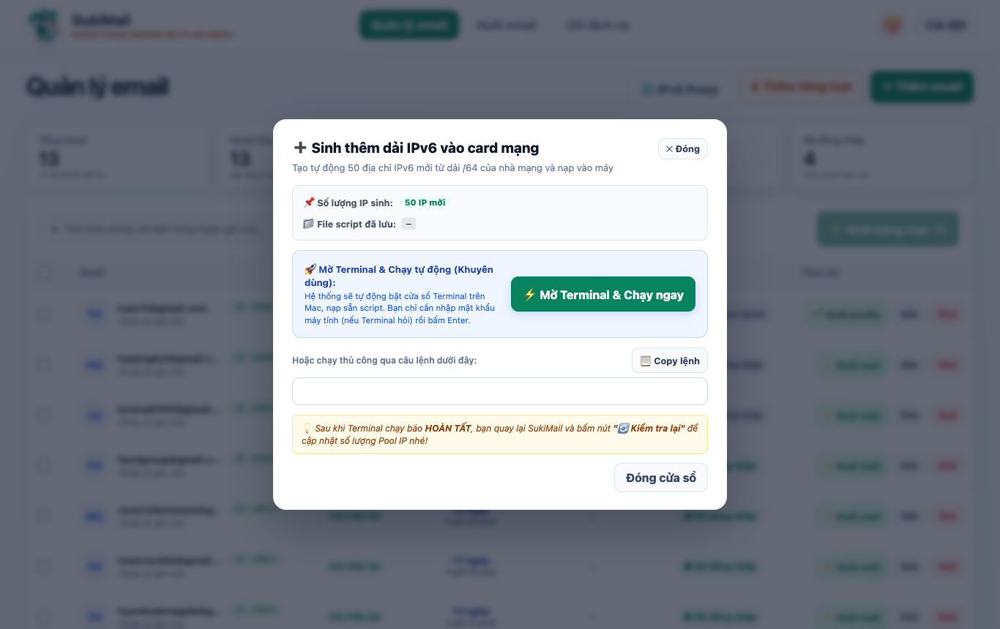
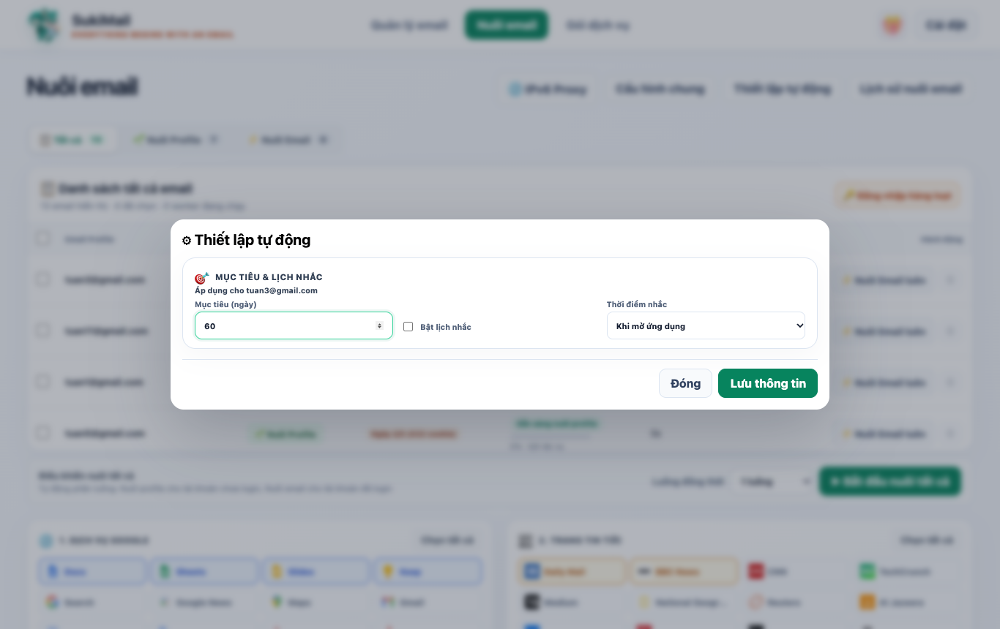
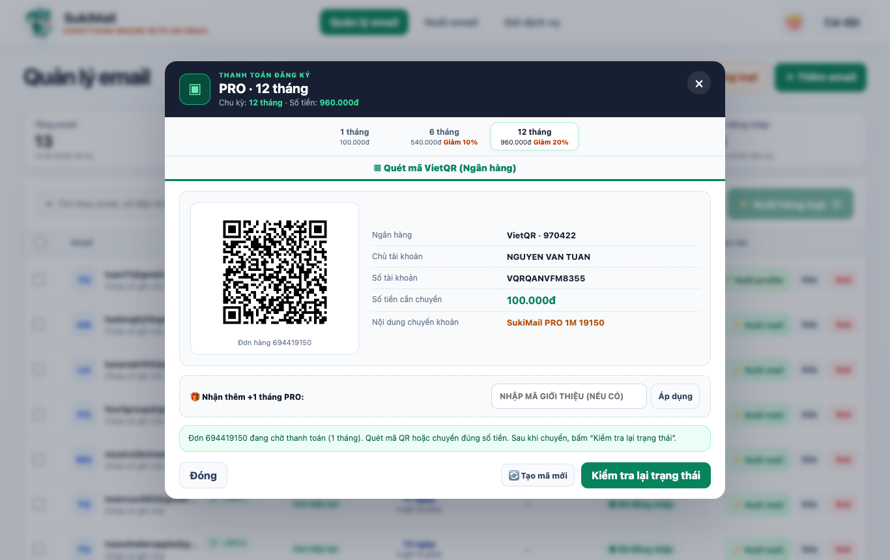
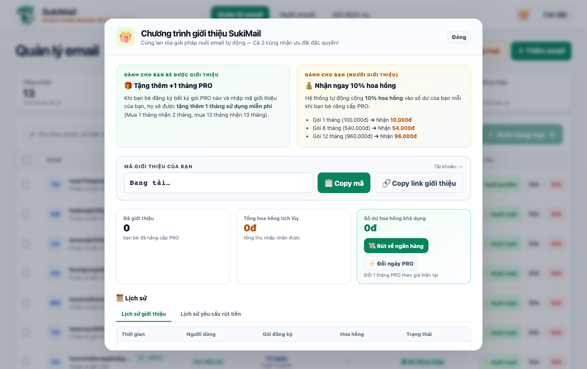

  

<h1 align="center">SukiMail</h1>

  <strong>Hệ Thống Quản Lý &amp; Nuôi Email Tự Động Hóa — EVERYTHING BEGINS WITH AN EMAIL</strong>

  
  &nbsp;
  

  <a href="README_EN.md">English</a>
  ·
  <a href="https://github.com/suki-app/sukimail-doc/releases/latest">Phiên bản mới nhất</a>
  ·
  <a href="#4-hướng-dẫn-cài-đặt--khởi-động">Hướng dẫn cài đặt</a>
  ·
  <a href="#6-xử-lý-sự-cố-thường-gặp-troubleshooting">Khắc phục sự cố</a>

> Phiên bản hiện tại: **SukiMail 1.0.0**. SukiMail là ứng dụng desktop chuyên nghiệp dành cho macOS và Windows. Giải pháp tối ưu hóa việc nuôi dưỡng và quản lý số lượng lớn tài khoản Google / Gmail độc lập, an toàn, hỗ trợ mạng IPv6 Proxy riêng biệt và gia tăng độ tin cậy (Trust Score) tự nhiên bằng hành vi người dùng thật.

---

## 📖 Mục lục

- [1. Giới thiệu tổng quan](#1-giới-thiệu-tổng-quan)
- [2. Các tính năng nổi bật](#2-các-tính-năng-nổi-bật)
- [3. Yêu cầu hệ thống](#3-yêu-cầu-hệ-thống)
- [4. Hướng dẫn cài đặt & Khởi động](#4-hướng-dẫn-cài-đặt--khởi-động)
- [5. Hướng dẫn sử dụng chi tiết](#5-hướng-dẫn-sử-dụng-chi-tiết)
  - [5.1. Quản lý danh sách email](#51-quản-lý-danh-sách-email)
  - [5.2. Nhập email hàng loạt (Bulk Import)](#52-nhập-email-hàng-loạt-bulk-import)
  - [5.3. Quản lý & Tạo Local IPv6 Proxy (/64)](#53-quản-lý--tạo-local-ipv6-proxy-64)
  - [5.4. Trình nuôi email & Tăng độ Trust](#54-trình-nuôi-email--tăng-độ-trust)
  - [5.5. Nuôi hàng loạt & Giao diện chuyển đổi List / Grid View](#55-nuôi-hàng-loạt--giao-diện-chuyển-đổi-list--grid-view)
  - [5.6. Cấu hình hành vi & Nuôi trước tạo lịch sử (Pre-warming)](#56-cấu-hình-hành-vi--nuôi-trước-tạo-lịch-sử-pre-warming)
  - [5.7. Lịch sử nuôi & Nhật ký chi tiết](#57-lịch-sử-nuôi--nhật-ký-chi-tiết)
  - [5.8. Gói dịch vụ & Thanh toán VietQR tự động](#58-gói-dịch-vụ--thanh-toán-vietqr-tự-động)
  - [5.9. Chương trình Giới thiệu nhận hoa hồng (Affiliate)](#59-chương-trình-giới-thiệu-nhận-hoa-hồng-affiliate)
  - [5.10. Cài đặt hệ thống & Đổi ngôn ngữ](#510-cài-đặt-hệ-thống--đổi-ngôn-ngữ)
- [6. Xử lý sự cố thường gặp (Troubleshooting)](#6-xử-lý-sự-cố-thường-gặp-troubleshooting)

---

## 1. Giới thiệu tổng quan

**SukiMail** là phần mềm desktop chuyên biệt cho việc nuôi dưỡng và quản lý số lượng lớn tài khoản Gmail. Điểm mấu chốt của SukiMail là **mỗi tài khoản email sở hữu một Chrome profile tách biệt hoàn toàn** (dữ liệu cookies, cache, lịch sử duyệt web riêng), kết hợp cùng động cơ tự động hóa giả lập thao tác người thật tự nhiên (Human-like behavior) nhằm vượt qua các thuật toán kiểm duyệt và hạn chế checkpoint của Google.

Ngoài ra, SukiMail tích hợp **Engine Local IPv6 Proxy** tiên tiến, cho phép tận dụng dải mạng `/64` miễn phí của nhà mạng để cấp cho từng email profile một địa chỉ IPv6 độc lập, chống dính chùm liên kết tài khoản (cross-ban) một cách triệt để.

---

## 2. Các tính năng nổi bật

- 🛡️ **Chrome Profile Độc Lập:** Mỗi tài khoản được cấp một thư mục User Data riêng biệt, không bị rò rỉ dữ liệu chéo giữa các tài khoản.
- 🌐 **Local IPv6 Proxy Engine (/64):**
  - Tự động nhận diện kết nối IPv6 và dải `/64` từ nhà mạng.
  - Tự động sinh kịch bản (Script) thêm hàng chục/hàng trăm địa chỉ IPv6 Alias miễn phí.
  - Mỗi tài khoản email được ánh xạ tới 1 cổng local riêng (`127.0.0.1:280xx`) và đi ra Internet với 1 IPv6 độc lập từ Pool.
  - Đầy đủ thao tác: **Test IP**, **Đổi cổng & IP**, **Bỏ proxy** đưa về mạng trực tiếp, Hủy gán hàng loạt.
  - Cơ chế bảo vệ chống trùng IP: Chặn gán/đổi khi hết IP trống trong Pool, đảm bảo nguyên tắc 1 Profile = 1 IPv6 riêng biệt.
- 🌱 **Nuôi Trước Tạo Lịch Sử (Pre-warming / History Seeding):**
  - Tùy chỉnh số ngày nuôi trước (ví dụ 3 – 30 ngày) để tích lũy cookies, cache, lịch sử tìm kiếm và duyệt web trước khi đưa tài khoản vào các tác vụ chính.
- 🤖 **Giả Lập Hành Vi Tự Nhiên Đa Dạng:**
  - **Google Workspace:** Soạn thảo Google Docs, bảng tính Sheets, trình chiếu Slides, ghi chú Keep, Forms, Drive.
  - **Dịch Vụ Google Khác:** Google Search đọc kết quả, Google Maps tìm đường, Google News xem tin, Google Photos, Translate, Google Earth.
  - **Tin Tức Báo Chí:** BBC News, Daily Mail, CNN, TechCrunch, Medium, NatGeo... kèm cơ chế cuộn trang, dừng đọc bài và click đọc bài viết liên quan ngẫu nhiên.
  - **Trí Tuệ Nhân Tạo (AI Tools):** Tương tác với ChatGPT, Google Gemini, Claude, Grok, Perplexity, Copilot...
  - **Mạng Xã Hội:** YouTube, Instagram, TikTok, Reddit, X (Twitter), Quora.
- ⚡ **Nuôi Hàng Loạt Đa Luồng (Parallel Workers):** Hỗ trợ cấu hình số lượng worker chạy đồng thời tùy chỉnh theo cấu hình máy tính.
- 🎛️ **Chuyển Đổi Hiển Thị Linh Hoạt (List / Grid View):**
  - Người dùng có thể chuyển đổi nhanh chỉ với 1 click giữa giao diện **Danh sách bảng (Table/List)** và giao diện **Lưới thẻ (Grid View)** hiển thị 3–4 card mỗi hàng trực quan.
- 🎯 **Mục Tiêu & Lịch Nhắc Tự Động:** Theo dõi chu kỳ nuôi mục tiêu (ví dụ 60 ngày), nhắc nhở khi mở app hoặc theo khung giờ cố định/ngẫu nhiên.
- 📜 **Lịch Sử & Nhật Ký Realtime:** Terminal ghi nhận chi tiết từng bước click, cuộn trang, thời gian ở lại trang và chấm điểm hoạt động (Activity Score).
- 💳 **Thanh Toán PRO Tự Động Qua VietQR:** Tích hợp quét mã QR ngân hàng tự động kích hoạt gói PRO trong 5–10 giây. Tùy chọn linh hoạt các chu kỳ 1 tháng, 6 tháng (giảm 10%), 12 tháng (giảm 20%).
- 🎁 **Chương Trình Giới Thiệu Nhận Hoa Hồng (Affiliate):**
  - Tặng mã giới thiệu riêng cho từng người dùng, nhận **20% hoa hồng** khi người được giới thiệu thanh toán PRO.
  - Người nhập mã nhận thêm **+1 tháng PRO** miễn phí khi thanh toán.
  - Quản lý số dư hoa hồng, hỗ trợ **Rút tiền về tài khoản ngân hàng** hoặc **Đổi thưởng thành ngày sử dụng PRO**.

---

## 3. Yêu cầu hệ thống

- **Hệ điều hành:** macOS 12 Monterey trở lên (Hỗ trợ cả Apple Silicon M1/M2/M3/M4 và Intel), Windows 10/11 (64-bit).
- **Trình duyệt:** Đã cài đặt **Google Chrome** chính thức trên máy tính.
- **Dung lượng trống:** Tối thiểu 2GB (để chứa các profile Chrome tách biệt và dữ liệu cookies/cache).

---

## 4. Hướng dẫn cài đặt & Khởi động

- **macOS:** Tải file `SukiMail.dmg`, nhấp đúp để mở rồi **kéo thả biểu tượng SukiMail vào thư mục Applications**. Sau đó mở app từ Launchpad hoặc Spotlight. Bộ cài đã đóng gói sẵn môi trường runtime độc lập, người dùng cuối không cần cài thêm Python hay thư viện dòng lệnh nào khác.
- **Windows:** Tải file `SukiMail_Setup.exe` và làm theo hướng dẫn cài đặt trên màn hình.

---

## 5. Hướng dẫn sử dụng chi tiết

### 5.1. Quản lý danh sách email

Tại tab **Quản lý email**, bạn có cái nhìn tổng quan về trạng thái của toàn bộ dàn tài khoản:
- Thống kê: Tổng email, Email còn hiệu lực, Đã đăng nhập, Đang chạy nuôi, Chờ thiết lập.
- Bảng danh sách email chi tiết: Avatar nhận diện, địa chỉ email, ghi chú, trạng thái hiệu lực, thời gian đã nuôi, lần nuôi gần nhất, trạng thái đăng nhập.
- **Huy hiệu Proxy IPv6 (`🌐 :port`):** Hiển thị cổng proxy riêng đang được gán cho email đó (nếu đã cấu hình).
- Bộ lọc tìm kiếm nhanh theo email, số điện thoại, ghi chú. Sắp xếp linh hoạt theo Hiệu lực, Thời gian nuôi, Trạng thái đăng nhập.

Để thêm từng email: nhấn nút **＋ Thêm email** ở góc phải:
- Hỗ trợ nhập Email, Mật khẩu, Secret key 2FA, Email khôi phục, Số điện thoại, Kênh liên kết và Ghi chú.

---

### 5.2. Nhập email hàng loạt (Bulk Import)

Khi sở hữu danh sách nhiều tài khoản, nhấn nút **⬇ Thêm hàng loạt**:
- Hỗ trợ định dạng phân tách bằng dấu `|`:
  - `email | mật_khẩu | mã_2FA`
  - hoặc `email | mật_khẩu | số_điện_thoại | mã_2FA`
- Tích chọn **"Tự động đăng nhập và tạo Chrome profile riêng"** để ứng dụng tự động mở từng profile và đăng nhập sẵn sàng.

---

### 5.3. Quản lý & Tạo Local IPv6 Proxy (/64)

Nhấn vào nút **🌐 IPv6 Proxy** ở góc trên màn Quản lý email để mở bảng điều khiển proxy:
- **Trạng thái kết nối IPv6:** Tự động phát hiện dải `/64` của nhà mạng, card mạng chính (`en0` / `Wi-Fi`), IP công cộng hiện tại.
- **Thống kê Pool IP chi tiết:** Hiển thị rõ tổng số IP trong Pool, số IP còn trống và số IP đã gán (ví dụ: `52 IP (Trống: 49 · Đã gán: 3)`).
- **Khởi động Proxy Server:** Bật/dừng engine proxy cục bộ đa cổng chỉ với 1 click.
- **Thao tác nhanh trên từng Profile:**
  - **`Test`**: Kiểm tra kết nối qua cổng local và xem địa chỉ IPv6 thực tế đi ra ngoài Internet.
  - **`Đổi`**: Đổi sang cổng local mới và cấp một IPv6 trống khác từ Pool.
  - **`Bỏ`**: Hủy gán proxy, chuyển email về dùng mạng IP trực tiếp.
  - **Nút hàng loạt**: Hỗ trợ *⚡ Tự động gán tất cả* và *✕ Hủy gán tất cả*.
- **Bảo vệ chống trùng IP:** Hệ thống tự động chặn gán/đổi khi hết IP trống trong Pool, yêu cầu người dùng sinh thêm IP để luôn đảm bảo **1 Profile = 1 IPv6 riêng biệt**.

Để bổ sung thêm nhiều IP mới từ dải `/64`, nhấn nút **➕ Sinh thêm IP /64**:
- Hệ thống tự động tạo file script lệnh (`.command` trên macOS hoặc `.bat/.ps1` trên Windows). Bạn chỉ cần nhấn **Chạy lệnh tự động** hoặc copy lệnh dán vào Terminal để thêm 50, 100 hay 500 IPv6 hoàn toàn miễn phí trong vài giây!

---

### 5.4. Trình nuôi email & Tăng độ Trust

Tab **Nuôi email** là trung tâm điều khiển và giám sát quá trình tự động hóa:
- **Thanh chọn email & Điều khiển đa luồng:** Chọn tài khoản cần kiểm tra, đăng nhập hoặc chạy đồng thời nhiều tài khoản song song.
- **Thước đo Trust & Hoạt động:** Điểm hoạt động ước tính (Trust Score), tiến độ mục tiêu, thời gian phiên, lượt tương tác Google Workspace, số bài báo đã đọc.
- **Bảng chọn hành vi (Bên trái):** Tùy chỉnh bật/tắt từng dịch vụ Google, trang tin tức, công cụ AI hoặc mạng xã hội.
- **Bảng điều khiển & Live Log (Bên phải):** Hiển thị tiến trình %, tác vụ hiện tại, thời gian dự kiến kết thúc và bảng nhật ký Terminal thời gian thực (hỗ trợ copy/xóa log).

---

### 5.5. Nuôi hàng loạt & Giao diện chuyển đổi List / Grid View

Khi bạn tích chọn nhiều email ở màn Quản lý email rồi nhấn **⚡ Nuôi hàng loạt**, ứng dụng sẽ chuyển sang màn hình điều khiển lượt nuôi:
- **Hỗ trợ 2 chế độ hiển thị:** Người dùng có thể linh hoạt chuyển đổi giữa dạng **Danh sách bảng (List View)** và dạng **Lưới thẻ (Grid View)** chỉ với 1 click vào icon chuyển đổi ở góc trên bảng nuôi.
- **Theo dõi đa luồng trực quan:** Hiển thị trực tiếp danh sách các tài khoản đang chạy song song, số worker đồng thời, tiến độ hoàn thành, tác vụ đang xử lý và thời lượng phiên.

---

### 5.6. Cấu hình hành vi & Nuôi trước tạo lịch sử (Pre-warming)

#### Cấu hình chung (Warmup Settings):
- Thiết lập **Số tác vụ mỗi phiên** (1–50 tác vụ).
- **Giãn cách ngẫu nhiên (delay):** Tránh bị phát hiện bot bằng cách nghỉ ngẫu nhiên giữa các thao tác.
- **Thời gian ở lại mỗi trang:** Giả lập thời gian đọc bài thực tế.
- **Tỷ lệ Click đọc tiếp bài viết liên quan:** Tự động điều hướng sang các liên kết hữu cơ.
- **Tùy chọn mở cửa sổ Chrome thật:** Cho phép xem trực tiếp quá trình bot thao tác hoặc ẩn ngầm.

#### Thiết lập tự động & Nuôi trước tạo lịch sử (Pre-warming):
- **Nuôi trước tạo lịch sử (Pre-warming):** Tích chọn để tự động tích lũy cookies, cache, lịch sử tìm kiếm và duyệt web trước khi đưa tài khoản vào các tác vụ chính. Tùy chỉnh số ngày nuôi trước phù hợp (từ 3 đến 30 ngày).
- Đặt mục tiêu chu kỳ nuôi (ví dụ: nuôi ổn định trong 60 ngày).
- Bật thông báo nhắc nhở khi mở ứng dụng hoặc vào khung giờ cố định/ngẫu nhiên trong ngày.

---

### 5.7. Lịch sử nuôi & Nhật ký chi tiết

Bấm vào nút **Lịch sử nuôi email** để kiểm tra thống kê qua từng phiên chạy:
- Thời gian chạy, Email, Trạng thái (Hoàn tất / Đã dừng), Thời lượng phiên, Số tác vụ hoàn thành và Điểm hoạt động tích lũy.
- Nhấn vào icon chi tiết `ⓘ` ở từng phiên để mở popup xem chi tiết từng thao tác kèm mốc thời gian (timestamp).

---

### 5.8. Gói dịch vụ & Thanh toán VietQR tự động

#### Gói dịch vụ (BASIC & PRO):
- **Gói BASIC:** Miễn phí, nuôi 1 email tại một thời điểm với các dịch vụ cốt lõi.
- **Gói PRO:** Mở khóa toàn bộ dịch vụ nâng cao, nuôi nhiều email song song cùng lúc, nhập hàng loạt, toàn quyền sử dụng IPv6 Proxy và thanh toán VietQR tự động.
- **Linh hoạt thời hạn đăng ký:**
  - **1 tháng:** 100.000đ
  - **6 tháng:** 540.000đ *(Tiết kiệm 10%)*
  - **12 tháng:** 960.000đ *(Tiết kiệm 20%)*

*Giao diện khi chọn chu kỳ 1 tháng:*

*Giao diện khi chọn chu kỳ 6 tháng (giảm 10%):*

*Giao diện khi chọn chu kỳ 12 tháng (giảm 20%):*

#### Thanh toán tự động qua VietQR:
- Nhấn **Nâng cấp PRO** hoặc **Thanh toán bằng QR**, hệ thống sẽ tạo ngay mã VietQR chuẩn ngân hàng với đúng số tiền và nội dung chuyển khoản bảo mật.
- Hỗ trợ nhập mã giới thiệu để nhận thêm **+1 tháng PRO** miễn phí.
- Sau khi chuyển khoản qua ứng dụng ngân hàng, hệ thống tự động kiểm tra và kích hoạt gói PRO chỉ sau 5–10 giây mà không cần thao tác thủ công.

---

### 5.9. Chương trình Giới thiệu nhận hoa hồng (Affiliate)

Nhấn vào icon hộp quà 🎁 ở góc trên màn hình hoặc nút **Giới thiệu nhận hoa hồng** tại tab Gói dịch vụ:
- **Mã giới thiệu & Link chia sẻ riêng:** Mỗi tài khoản sở hữu một mã giới thiệu độc quyền để gửi cho bạn bè hoặc cộng đồng.
- **Chính sách hoa hồng:** Nhận ngay **20% hoa hồng** trên mỗi đơn hàng nâng cấp PRO thành công từ người được bạn giới thiệu.
- **Quyền lợi cho người được giới thiệu:** Nhận thêm **+1 tháng PRO** hoàn toàn miễn phí khi nhập mã lúc thanh toán.
- **Minh bạch tài chính:** Bảng thống kê chi tiết số lượt giới thiệu, doanh số, hoa hồng đã nhận và số dư khả dụng.

#### Rút tiền hoặc Đổi thưởng:
- **Rút tiền về ngân hàng:** Khi số dư tích lũy đạt tối thiểu 100.000đ, bạn có thể gửi yêu cầu rút tiền về bất kỳ tài khoản ngân hàng nào tại Việt Nam.
- **Đổi thời hạn PRO:** Có thể dùng trực tiếp số dư hoa hồng để quy đổi thành thời hạn sử dụng gói SukiMail PRO mà không cần nạp thêm tiền.

---

### 5.10. Cài đặt hệ thống & Đổi ngôn ngữ

Tại tab **Cài đặt**:
- Xem thông tin tài khoản đang đăng nhập và gói bản quyền hiện tại.
- Lựa chọn ngôn ngữ hiển thị: **Tiếng Việt 🇻🇳** hoặc **English 🇬🇧**.
- Thông tin phiên bản phần mềm, hướng dẫn sử dụng và liên kết hỗ trợ kỹ thuật.

---

## 6. Xử lý sự cố thường gặp (Troubleshooting)

### 1. Báo lỗi "Profile đang mở trong Chrome / Profile đang bị giữ"
- **Nguyên nhân:** Cửa sổ Chrome của profile email đó đang mở thủ công hoặc một phiên trước chưa đóng hẳn tiến trình.
- **Cách khắc phục:** Đóng các cửa sổ Google Chrome đang mở của email đó, hoặc nhấn nút **Thử lại** trên giao diện SukiMail để hệ thống tự động giải phóng lock file.

### 2. Báo lỗi "Proxy server chưa mở" khi bấm Test, Đổi hoặc Gán
- **Nguyên nhân:** Engine Proxy Server đang ở trạng thái dừng.
- **Cách khắc phục:** Tại popup Quản lý IPv6 Proxy, nhấn nút **▶ Khởi động Proxy Server**. Khi nhãn trạng thái chuyển sang màu xanh (*Proxy Server: Đang chạy*), bạn có thể thoải mái thực hiện các thao tác gán và test IP.

### 3. Thông báo "Đã hết địa chỉ IPv6 khả dụng trong Pool"
- **Nguyên nhân:** Toàn bộ IPv6 trong Pool đã được gán cho các profile khác (nguyên tắc 1 Profile = 1 IPv6 độc lập).
- **Cách khắc phục:** Nhấn nút **➕ Sinh thêm IP /64**, chọn số lượng IP muốn tạo (ví dụ 50 hoặc 100 IP) và chạy lệnh để bổ sung thêm dải IP mới vào card mạng.

### 4. Cần làm mới trạng thái đăng nhập Google
- Nếu tài khoản bị đăng xuất hoặc đổi mật khẩu: tại tab **Nuôi email**, chọn email tương ứng và nhấn nút **🔑 Đăng nhập email**. Ứng dụng sẽ mở cửa sổ Chrome với đúng profile đó để bạn đăng nhập trực tiếp. Sau khi đăng nhập thành công, nhấn **🔍 Kiểm Tra** để SukiMail ghi nhận trạng thái mới.

---

  <b>SukiMail</b> • Hệ thống quản lý &amp; nuôi email tự động hóa hàng đầu • Everything begins with an email.

