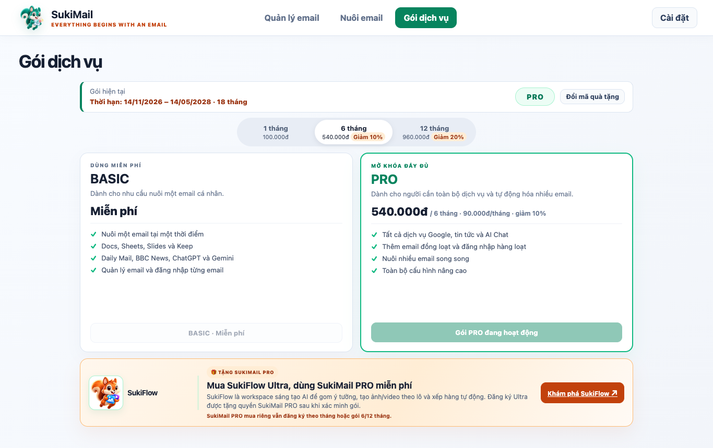

<p align="center">
  
</p>

<h1 align="center">SukiMail</h1>

<p align="center">
  <strong>Hệ Thống Quản Lý &amp; Nuôi Email Tự Động Hóa — EVERYTHING BEGINS WITH AN EMAIL</strong>
</p>

<p align="center">
  <a href="https://github.com/suki-app/sukimail-doc/releases/latest/download/SukiMail_Setup_v1.0.0.exe"></a>
  &nbsp;
  <a href="https://github.com/suki-app/sukimail-doc/releases/latest/download/SukiMail_macOS_v1.0.0_arm64.dmg"></a>
</p>

<p align="center">
  <a href="README_EN.md">English</a>
  ·
  <a href="https://github.com/suki-app/sukimail-doc/releases/latest">Phiên bản mới nhất</a>
  ·
  <a href="#4-hướng-dẫn-cài-đặt--khởi-động">Hướng dẫn cài đặt</a>
  ·
  <a href="#6-xử-lý-sự-cố-thường-gặp-troubleshooting">Khắc phục sự cố</a>
</p>

> Phiên bản hiện tại: **SukiMail 1.0.0**. SukiMail là ứng dụng desktop dành cho macOS và Windows. Giải pháp nuôi tài khoản Google / Gmail độc lập, an toàn và gia tăng độ tin cậy (Trust Score) tự nhiên bằng hành vi người dùng thật.

---

## 📖 Mục lục

- [1. Giới thiệu tổng quan](#1-giới-thiệu-tổng-quan)
- [2. Các tính năng nổi bật](#2-các-tính-năng-nổi-bật)
- [3. Yêu cầu hệ thống](#3-yêu-cầu-hệ-thống)
- [4. Hướng dẫn cài đặt & Khởi động](#4-hướng-dẫn-cài-đặt--khởi-động)
  - [Cách 1: Khởi động 1-click (Khuyên dùng trên macOS)](#cách-1-khởi-động-1-click-khuyên-dùng-trên-macos)
  - [Cách 2: Chạy thủ công từ Terminal / Dòng lệnh](#cách-2-chạy-thủ-công-từ-terminal--dòng-lệnh)
- [5. Hướng dẫn sử dụng chi tiết](#5-hướng-dẫn-sử-dụng-chi-tiết)
  - [5.1. Quản lý danh sách email](#51-quản-lý-danh-sách-email)
  - [5.2. Nhập email hàng loạt (Bulk Import)](#52-nhập-email-hàng-loạt-bulk-import)
  - [5.3. Trình nuôi email & Tăng độ Trust](#53-trình-nuôi-email--tăng-độ-trust)
  - [5.4. Chế độ nuôi hàng loạt & Tùy chọn giao diện List / Grid View](#54-chế-độ-nuôi-hàng-loạt--tùy-chọn-giao-diện-list--grid-view)
  - [5.5. Cấu hình hành vi & Thiết lập tự động](#55-cấu-hình-hành-vi--thiết-lập-tự-động)
  - [5.6. Lịch sử nuôi & Nhật ký chi tiết](#56-lịch-sử-nuôi--nhật-ký-chi-tiết)
  - [5.7. Gói dịch vụ & Cài đặt hệ thống](#57-gói-dịch-vụ--cài-đặt-hệ-thống)
- [6. Xử lý sự cố thường gặp (Troubleshooting)](#6-xử-lý-sự-cố-thường-gặp-troubleshooting)

---

## 1. Giới thiệu tổng quan

**SukiMail** là phần mềm desktop chuyên biệt cho việc nuôi dưỡng và quản lý số lượng lớn tài khoản Gmail. Điểm mấu chốt của SukiMail là **mỗi tài khoản email sở hữu một Chrome profile tách biệt hoàn toàn** (dữ liệu cookies, cache, lịch sử duyệt web riêng), kết hợp cùng động cơ tự động hóa giả lập thao tác người thật tự nhiên (Human-like behavior) nhằm vượt qua các thuật toán kiểm duyệt và hạn chế checkpoint của Google.

---

## 2. Các tính năng nổi bật

- 🛡️ **Chrome Profile Độc Lập:** Mỗi tài khoản được cấp một thư mục User Data riêng biệt, không bị rò rỉ dữ liệu chéo giữa các tài khoản.
- 🤖 **Giả Lập Hành Vi Tự Nhiên Đa Dạng:**
  - **Google Workspace:** Soạn thảo Google Docs, bảng tính Sheets, trình chiếu Slides, ghi chú Keep, Forms, Drive.
  - **Dịch Vụ Google Khác:** Google Search đọc kết quả, Google Maps tìm đường, Google News xem tin, Google Photos, Translate, Google Earth.
  - **Tin Tức Báo Chí:** BBC News, Daily Mail, CNN, TechCrunch, Medium, NatGeo... kèm cơ chế cuộn trang, dừng đọc bài và click đọc bài viết liên quan ngẫu nhiên.
  - **Trí Tuệ Nhân Tạo (AI Tools):** Tương tác với ChatGPT, Google Gemini, Claude, Grok, Perplexity, Copilot...
  - **Mạng Xã Hội:** YouTube, Instagram, TikTok, Reddit, X (Twitter), Quora.
- ⚡ **Nuôi Hàng Loạt Đa Luồng (Parallel Workers):** Hỗ trợ cấu hình số lượng worker chạy đồng thời tùy chỉnh theo cấu hình máy tính.
- 🎛️ **Chuyển Đổi Hiển Thị Linh Hoạt (List / Grid View):**
  - Tại màn hình nuôi email, người dùng có thể chuyển đổi nhanh chỉ với 1 click giữa giao diện **Danh sách bảng (Table/List)** và giao diện **Lưới thẻ (Grid View)** hiển thị 3–4 card mỗi hàng trực quan, đẹp mắt.
- 🎯 **Mục Tiêu & Lịch Nhắc Tự Động:** Theo dõi chu kỳ nuôi mục tiêu (ví dụ 60 ngày), nhắc nhở khi mở app hoặc theo khung giờ cố định/ngẫu nhiên.
- 📜 **Lịch Sử & Nhật Ký Realtime:** Terminal ghi nhận chi tiết từng bước click, cuộn trang, thời gian ở lại trang và chấm điểm hoạt động (Activity Score).
- 💳 **Thanh Toán Gói Dịch Vụ PRO VietQR:** Quét mã QR chuyển khoản tự động kích hoạt quyền lợi nâng cao.

---

## 3. Yêu cầu hệ thống

- **Hệ điều hành:** macOS 12 Monterey trở lên (Hỗ trợ cả Apple Silicon M1/M2/M3/M4 và Intel), Windows 10/11 hoặc Linux.
- **Trình duyệt:** Đã cài đặt **Google Chrome** chính thức tại `/Applications/Google Chrome.app`.
- **Python:** Phiên bản 3.10 trở lên.
- **Dung lượng trống:** Tối thiểu 2GB (để chứa các profile Chrome tách biệt).

---

## 4. Hướng dẫn cài đặt & Khởi động

### Cách 1: Khởi động 1-click (Khuyên dùng trên macOS)

Trong thư mục `App`, file thực thi đã được chuẩn bị sẵn:
1. Nhấp đúp vào file `Chay_SukiMail_macOS.command`.
2. Script sẽ tự động:
   - Kiểm tra và tạo môi trường ảo Python (`.venv`) nếu chưa có.
   - Cài đặt đầy đủ các thư viện phụ thuộc từ `requirements.txt`.
   - Khởi động backend FastAPI tại cổng `4751` và mở cửa sổ ứng dụng desktop native (`pywebview`).

> *Mẹo:* Nếu gặp thông báo bảo mật của macOS ("Unidentified developer"), chuột phải vào file `Chay_SukiMail_macOS.command` ➜ chọn **Open** ➜ nhấn **Open**.

---

### Cách 2: Chạy thủ công từ Terminal / Dòng lệnh

Nếu muốn chạy qua terminal hoặc tùy biến cấu hình:

```bash
# 1. Di chuyển vào thư mục ứng dụng
cd Documents/SukiMail/App

# 2. Tạo môi trường ảo và kích hoạt
python3 -m venv .venv
source .venv/bin/activate

# 3. Cài đặt các gói phụ thuộc
pip install -r requirements.txt

# 4. Khởi chạy ứng dụng Desktop
export SUKIMAIL_DATA_ROOT="$(dirname "$PWD")/Data"
python desktop_app.py
```

Ứng dụng cũng có thể truy cập trực tiếp qua trình duyệt web tại địa chỉ: `http://127.0.0.1:4751/sukimail`.

---

## 5. Hướng dẫn sử dụng chi tiết

### 5.1. Quản lý danh sách email

Tại tab **Quản lý email**, bạn có cái nhìn tổng quan về trạng thái của toàn bộ dàn tài khoản:
- Thống kê: Tổng email, Email còn hiệu lực, Đã đăng nhập, Đang chạy nuôi, Chờ thiết lập.
- Bảng danh sách email chi tiết: Avatar nhận diện, địa chỉ email, ghi chú, trạng thái hiệu lực, thời gian đã nuôi, lần nuôi gần nhất, trạng thái đăng nhập.
- Bộ lọc tìm kiếm nhanh theo email, số điện thoại, ghi chú.
- Sắp xếp linh hoạt theo Hiệu lực, Thời gian nuôi, Trạng thái đăng nhập.


Để thêm từng email: nhấn nút **＋ Thêm email** ở góc phải:
- Hỗ trợ nhập Email, Mật khẩu, Secret key 2FA, Email khôi phục, Số điện thoại, Kênh liên kết và Ghi chú.


---

### 5.2. Nhập email hàng loạt (Bulk Import)

Khi sở hữu danh sách nhiều tài khoản, nhấn nút **⬇ Thêm hàng loạt**:
- Hỗ trợ định dạng phân tách bằng dấu `|`:
  - `email | mật_khẩu | mã_2FA`
  - hoặc `email | mật_khẩu | số_điện_thoại | mã_2FA`
- Tích chọn **"Tự động đăng nhập và tạo Chrome profile riêng"** để ứng dụng tự động mở từng profile và đăng nhập sẵn sàng.


---

### 5.3. Trình nuôi email & Tăng độ Trust

Tab **Nuôi email** là trung tâm điều khiển và giám sát quá trình tự động hóa:
- **Thanh chọn email & Điều khiển đa luồng:** Chọn tài khoản cần kiểm tra, đăng nhập hoặc chạy đồng thời nhiều tài khoản song song.
- **Thước đo Trust & Hoạt động:** Điểm hoạt động ước tính (Trust Score), tiến độ mục tiêu, thời gian phiên, lượt tương tác Google Workspace, số bài báo đã đọc.
- **Bảng chọn hành vi (Bên trái):** Tùy chỉnh bật/tắt từng dịch vụ Google, trang tin tức, công cụ AI hoặc mạng xã hội.
- **Bảng điều khiển & Live Log (Bên phải):** Hiển thị tiến trình %, tác vụ hiện tại, thời gian dự kiến kết thúc và bảng nhật ký Terminal thời gian thực (hỗ trợ copy/xóa log).


---

### 5.4. Chế độ nuôi hàng loạt & Tùy chọn giao diện List / Grid View

Khi bạn tích chọn từ 1 đến 10 email ở màn Quản lý email rồi nhấn **⚡ Nuôi hàng loạt**, ứng dụng sẽ chuyển sang màn hình điều khiển lượt nuôi:
- **Hỗ trợ 2 chế độ hiển thị:** Người dùng có thể linh hoạt chuyển đổi giữa dạng **Danh sách bảng (List View)** và dạng **Lưới thẻ (Grid View)** chỉ với 1 click vào 2 icon chuyển đổi ở góc trên bảng nuôi.
- **Theo dõi đa luồng trực quan:** Hiển thị trực tiếp danh sách các tài khoản đang chạy song song, số worker đồng thời, tiến độ hoàn thành, tác vụ đang xử lý và thời lượng phiên.


---

### 5.5. Cấu hình hành vi & Thiết lập tự động

#### Cấu hình chung (Warmup Settings):
- Thiết lập **Số tác vụ mỗi phiên** (1–50 tác vụ).
- **Giãn cách ngẫu nhiên (delay):** Tránh bị phát hiện bot bằng cách nghỉ ngẫu nhiên giữa các thao tác.
- **Thời gian ở lại mỗi trang:** Giả lập thời gian đọc bài thực tế.
- **Tỷ lệ Click đọc tiếp bài viết liên quan:** Tự động điều hướng sang các liên kết hữu cơ.
- **Tùy chọn mở cửa sổ Chrome thật:** Cho phép xem trực tiếp quá trình bot thao tác hoặc ẩn ngầm.


#### Thiết lập tự động & Lịch nhắc:
- Đặt mục tiêu chu kỳ nuôi (ví dụ: nuôi ổn định trong 60 ngày).
- Bật thông báo nhắc nhở khi mở ứng dụng hoặc vào khung giờ cố định/ngẫu nhiên trong ngày.


---

### 5.6. Lịch sử nuôi & Nhật ký chi tiết

Bấm vào nút **Lịch sử nuôi email** để kiểm tra thống kê qua từng phiên chạy:
- Thời gian chạy, Email, Trạng thái (Hoàn tất / Đã dừng), Thời lượng phiên, Số tác vụ hoàn thành và Điểm hoạt động tích lũy.
- Nhấn vào icon chi tiết `ⓘ` ở từng phiên để mở popup xem chi tiết từng thao tác kèm mốc thời gian (timestamp).


---

### 5.7. Gói dịch vụ & Cài đặt hệ thống

#### Gói dịch vụ (BASIC & PRO):
- **Gói BASIC:** Miễn phí, nuôi 1 email tại một thời điểm với các dịch vụ cốt lõi.
- **Gói PRO:** Mở khóa toàn bộ dịch vụ nâng cao, nuôi nhiều email song song cùng lúc, nhập hàng loạt và hỗ trợ thanh toán VietQR tự động.
- **Linh hoạt thời hạn:** Dễ dàng chuyển đổi giữa các chu kỳ để nhận chiết khấu: **1 tháng (100.000đ)**, **6 tháng (540.000đ · Giảm 10%)** hoặc **12 tháng (960.000đ · Giảm 20%)**.

*Giao diện gói dịch vụ chu kỳ 1 tháng:*


*Giao diện khi chọn chu kỳ 6 tháng (giá tự động cập nhật giảm 10%):*


*Giao diện khi chọn chu kỳ 12 tháng (giá tự động cập nhật giảm 20%):*


#### Cài đặt:
- Xem thông tin tài khoản đang đăng nhập.
- Lựa chọn ngôn ngữ hiển thị: **Tiếng Việt 🇻🇳** hoặc **English 🇬🇧**.
- Các liên kết hỗ trợ và hướng dẫn người dùng.


---

## 6. Xử lý sự cố thường gặp (Troubleshooting)

### 1. Báo lỗi "Profile đang mở trong Chrome / Profile đang bị giữ"
- **Nguyên nhân:** Cửa sổ Chrome của profile email đó đang mở thủ công hoặc một phiên trước chưa đóng hẳn tiến trình.
- **Cách khắc phục:** Đóng các cửa sổ Google Chrome đang mở của email đó, hoặc nhấn nút **Thử lại** trên giao diện SukiMail để hệ thống tự động giải phóng lock file.

### 2. Không khởi động được script trên macOS
- Mở Terminal và cấp quyền thực thi cho file lệnh:
  ```bash
  chmod +x "/Users/macpro/Documents/SukiMail/App/Chay_SukiMail_macOS.command"
  ```

### 3. Cần làm mới trạng thái đăng nhập Google
- Nếu tài khoản bị đăng xuất hoặc đổi mật khẩu: tại tab **Nuôi email**, chọn email tương ứng và nhấn nút **🔑 Đăng nhập email**. Ứng dụng sẽ mở cửa sổ Chrome với đúng profile đó để bạn đăng nhập trực tiếp. Sau khi đăng nhập thành công, nhấn **🔍 Kiểm Tra** để SukiMail ghi nhận trạng thái mới.

---

<p align="center">
  <b>SukiMail</b> • Phát triển với mục tiêu bảo vệ và tối ưu độ tin cậy tài khoản số của bạn.
</p>


<br><br>

---
---

<a name="-english-version"></a>
# 🇬🇧 English Version

<p align="center">
  
</p>

<h1 align="center">SukiMail</h1>

<p align="center">
  <strong>Automated Email Management &amp; Warmup System — EVERYTHING BEGINS WITH AN EMAIL</strong>
</p>

<p align="center">
  <a href="https://github.com/suki-app/sukimail-doc/releases/latest/download/SukiMail_Setup_v1.0.0.exe"></a>
  &nbsp;
  <a href="https://github.com/suki-app/sukimail-doc/releases/latest/download/SukiMail_macOS_v1.0.0_arm64.dmg"></a>
</p>

<p align="center">
  <a href="#✉️-sukimail--hệ-thống-quản-lý--nuôi-email-tự-động-hóa">🇻🇳 Back to Vietnamese</a>
  ·
  <a href="https://github.com/suki-app/sukimail-doc/releases/latest">Latest Release</a>
  ·
  <a href="README_EN.md">Standalone English File</a>
</p>

> Current version: **SukiMail 1.0.0**. SukiMail is a desktop application for macOS and Windows. Dedicated to multi-account Google/Gmail warmup with isolated Chrome profiles and human-like engagement.

---

## 📖 Table of Contents

- [1. Overview](#1-overview)
- [2. Key Features](#2-key-features)
- [3. System Requirements](#3-system-requirements)
- [4. Installation & Getting Started](#4-installation--getting-started)
  - [Method 1: 1-Click Launch (Recommended for macOS)](#method-1-1-click-launch-recommended-for-macos)
  - [Method 2: Manual Launch via Terminal / CLI](#method-2-manual-launch-via-terminal--cli)
- [5. Detailed User Guide](#5-detailed-user-guide)
  - [5.1. Email Management](#51-email-management)
  - [5.2. Bulk Email Import](#52-bulk-email-import)
  - [5.3. Email Warmup & Trust Booster](#53-email-warmup--trust-booster)
  - [5.4. Batch Warmup & List / Grid View Switcher](#54-batch-warmup--list--grid-view-switcher)
  - [5.5. Behavior Settings & Automated Schedules](#55-behavior-settings--automated-schedules)
  - [5.6. Warmup History & Detailed Logs](#56-warmup-history--detailed-logs)
  - [5.7. Subscription Plans & System Settings](#57-subscription-plans--system-settings)
- [6. Troubleshooting](#6-troubleshooting)

---

## 1. Overview

**SukiMail** is a dedicated desktop application engineered for warming up and managing multiple Gmail accounts safely at scale. The cornerstone of SukiMail is that **each email account operates within an independent, isolated Chrome profile** (separate cookies, cache, storage, and browsing history). Coupled with a human-emulation engine, SukiMail mimics organic user interactions to establish strong account credibility and minimize Google checkpoints.

---

## 2. Key Features

- 🛡️ **Isolated Chrome Profiles:** Every account is assigned its own isolated Chrome profile directory, preventing cross-profile tracking and data leaks.
- 🤖 **Realistic Human Behavior Simulation:**
  - **Google Workspace:** Document drafting on Google Docs, spreadsheets on Sheets, presentations on Slides, note-taking on Keep, Forms, and Drive.
  - **Google Services:** Google Search with organic result reading, Google Maps navigation, Google News browsing, Photos, Translate, and Google Earth exploration.
  - **Trusted News Outlets:** Organic reading on BBC News, Daily Mail, CNN, TechCrunch, Medium, NatGeo... featuring randomized page scrolls, dwell time, and related article click-throughs.
  - **AI Chat Platforms:** Engages with ChatGPT, Google Gemini, Claude, Grok, Perplexity, Copilot...
  - **Social Media:** Explores YouTube, Instagram, TikTok, Reddit, X (Twitter), and Quora.
- ⚡ **Multi-threaded Batch Warmup (Parallel Workers):** Run concurrent warmup workers tailored to your system's hardware capability.
- 🎛️ **Flexible Display Modes (List / Grid View):**
  - In the Warmup tab, toggle seamlessly with a single click between **Table/List View** and an elegant **Grid View** displaying 3 to 4 responsive cards per row with status badges, progress metrics, and action buttons.
- 🎯 **Goals & Automated Reminders:** Set session targets (e.g., 60-day warmup cycles) with automated notifications on app launch or during scheduled time windows.
- 📜 **Real-time Logs & History:** In-app terminal displaying step-by-step actions, dwell duration, and estimated Activity Trust Scores.
- 💳 **VietQR Integrated Upgrades:** Quick subscription unlock via automated VietQR banking transfers.

---

## 3. System Requirements

- **Operating System:** macOS 12 Monterey or newer (Fully compatible with Apple Silicon M1/M2/M3/M4 & Intel), Windows 10/11, or Linux.
- **Browser:** Official **Google Chrome** installed at `/Applications/Google Chrome.app`.
- **Python:** Version 3.10 or higher.
- **Disk Space:** Minimum 2 GB free storage (to accommodate isolated Chrome profiles).

---

## 4. Installation & Getting Started

### Method 1: 1-Click Launch (Recommended for macOS)

In the `App` directory, a ready-to-run launcher script is provided:
1. Double-click `Chay_SukiMail_macOS.command`.
2. The script will automatically:
   - Create a Python virtual environment (`.venv`) if one does not exist.
   - Install all required dependencies from `requirements.txt`.
   - Start the local FastAPI server at port `4751` and present the native desktop window (`pywebview`).

> *Tip:* If macOS shows an "Unidentified developer" prompt, right-click `Chay_SukiMail_macOS.command` ➜ select **Open** ➜ click **Open**.

---

### Method 2: Manual Launch via Terminal / CLI

For command-line control or development:

```bash
# 1. Navigate to the application directory
cd Documents/SukiMail/App

# 2. Create and activate virtual environment
python3 -m venv .venv
source .venv/bin/activate

# 3. Install dependencies
pip install -r requirements.txt

# 4. Launch Desktop App
export SUKIMAIL_DATA_ROOT="$(dirname "$PWD")/Data"
python desktop_app.py
```

You can also access the application directly via any web browser at: `http://127.0.0.1:4751/sukimail`.

---

## 5. Detailed User Guide

### 5.1. Email Management

The **Email Management** tab offers a centralized dashboard to inspect your entire account inventory:
- Metrics: Total Emails, Valid Accounts, Signed-in Profiles, Active Warmup Workers, Pending Setup.
- Detailed Table: Account avatar, email address, custom notes, validity status, total warmup duration, last session date, and login state.
- Real-time search by email address, phone number, or notes.
- Quick sorting by Validity, Warmup Time, or Login Status.


To add accounts individually, click **＋ Thêm email** (Add Email) on the top right:
- Input Email, Password, 2FA Secret Key, Recovery Email, Phone Number, Linked Channel, and Notes.


---

### 5.2. Bulk Email Import

When onboarding a large list of accounts, click **⬇ Thêm hàng loạt** (Bulk Add):
- Supports pipe-delimited format (`|`):
  - `email | password | 2FA_secret`
  - or `email | password | phone_number | 2FA_secret`
- Check **"Tự động đăng nhập và tạo Chrome profile riêng"** to let the app automatically initialize Chrome profiles and sign in.


---

### 5.3. Email Warmup & Trust Booster

The **Email Warmup** tab is your mission control for automated engagement:
- **Account Selector & Multi-Worker Control:** Choose an account to inspect, authenticate, or run multiple parallel accounts concurrently.
- **Trust & Activity Metrics:** Estimated Activity Score (Trust Booster), Goal Progress, Current Session Duration, Workspace Interactions, Articles Read.
- **Behavior Matrix (Left):** Toggle specific Google services, news sites, AI platforms, or social media networks.
- **Control & Live Logs (Right):** Monitor percentage progress, active tasks, estimated completion time, and a real-time terminal with copy/clear controls.


---

### 5.4. Batch Warmup & List / Grid View Switcher

Select multiple active accounts (up to 10 per batch) on the Email Management screen and click **⚡ Nuôi hàng loạt** (Batch Warmup):
- **Flexible Display Modes:** Seamlessly toggle between **Table / List View** and **Card Grid View** with a single click on the view switcher icons on the toolbar.
- **Real-time Parallel Monitoring:** Track all concurrent worker threads side-by-side with live progress bars, active step indicators, and session durations.


---

### 5.5. Behavior Settings & Automated Schedules

#### General Warmup Settings:
- Configure **Tasks per Session** (1–50 tasks).
- **Randomized Delays:** Natural pause intervals between actions to mimic human pacing.
- **Page Dwell Time:** Realistic reading duration per article or web page.
- **Related Link Click-through Rate:** Frequency of browsing secondary related articles.
- **Show Real Chrome Window:** Toggle between watching the automation live or running silently.


#### Goals & Reminder Schedules:
- Set warmup day targets (e.g., a 60-day steady account maturation goal).
- Enable daily reminders on application launch or during specific timeframes.


---

### 5.6. Warmup History & Detailed Logs

Click **Lịch sử nuôi email** (Warmup History) to review all completed sessions:
- Timestamp, Email, Status (Done / Stopped), Duration, Tasks Completed, and Activity Score.
- Click the detail icon `ⓘ` on any entry to view chronological action logs.


---

### 5.7. Subscription Plans & System Settings

#### Plans (BASIC & PRO):
- **BASIC Plan:** Free tier, 1 concurrent account warmup with core services.
- **PRO Plan:** Unlocks all advanced services, multi-account parallel workers, bulk operations, and VietQR instant activation.
- **Flexible Billing Cycles:** Seamlessly toggle between billing terms for discounts: **1 Month (100,000 VND)**, **6 Months (540,000 VND · Save 10%)**, or **12 Months (960,000 VND · Save 20%)**.

*1-Month Plan Billing View:*


*6-Month Plan Billing View (10% discount):*


*12-Month Plan Billing View (20% discount):*


#### Settings:
- View active signed-in user credentials.
- Switch display language: **Tiếng Việt 🇻🇳** or **English 🇬🇧**.
- Support resources and documentation links.


---

## 6. Troubleshooting

### 1. "Profile đang mở trong Chrome / Profile đang bị giữ" (Profile is locked)
- **Cause:** The Google Chrome window for that email profile is still open, or a previous process did not exit cleanly.
- **Solution:** Close any Google Chrome windows running that account, or click the **Thử lại** (Retry) button in SukiMail to automatically clear the lock file.

### 2. Launch script permission error on macOS
- Open Terminal and grant execute permissions:
  ```bash
  chmod +x "/Users/macpro/Documents/SukiMail/App/Chay_SukiMail_macOS.command"
  ```

### 3. Re-authenticating a Google Account
- If Google requests password re-entry or 2FA verification: navigate to the **Nuôi email** (Warmup) tab, select the account, and click **🔑 Đăng nhập email**. SukiMail will open the exact Chrome profile for you to complete sign-in manually. Once finished, click **🔍 Kiểm Tra** (Check) to update the login status.

---

<p align="center">
  <b>SukiMail</b> • Built to protect, nurture, and maximize your digital account trust.
</p>
