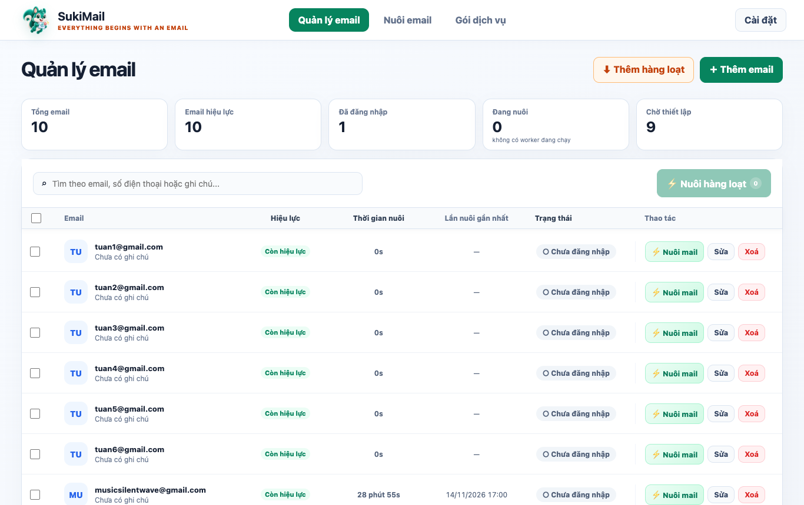
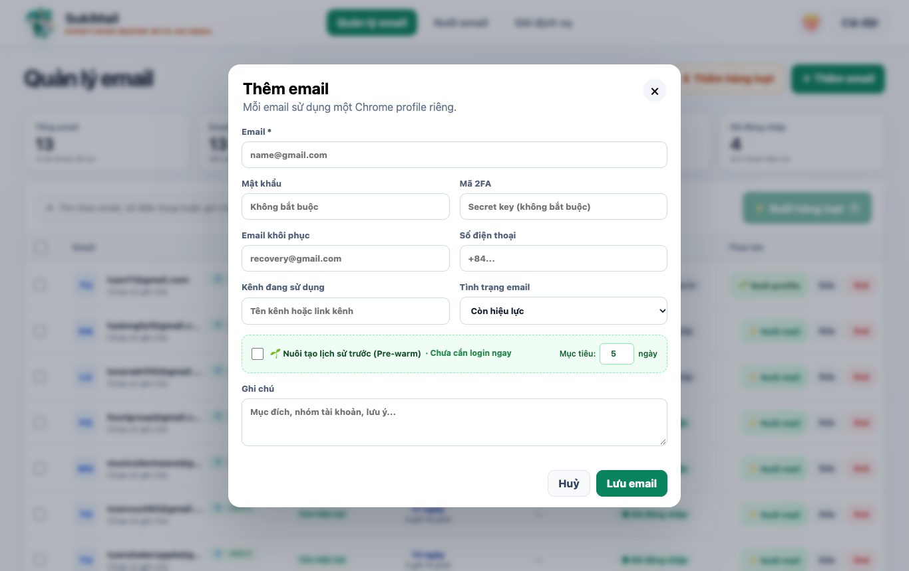
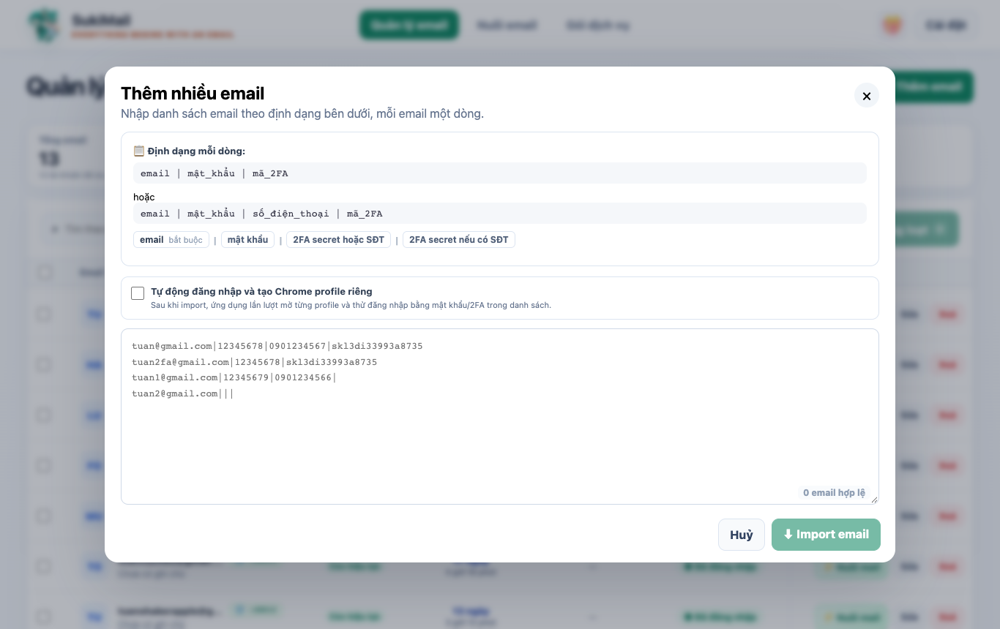
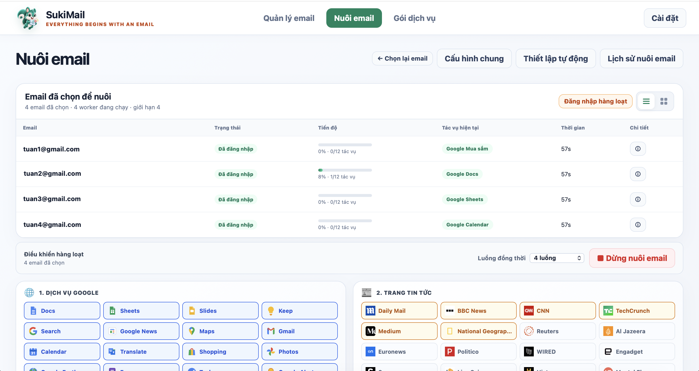
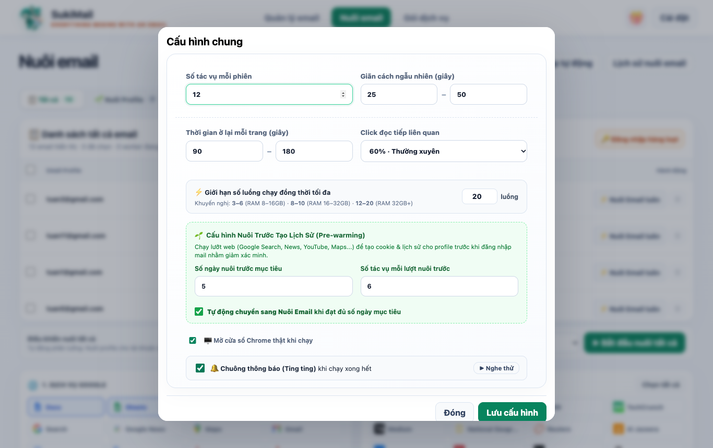
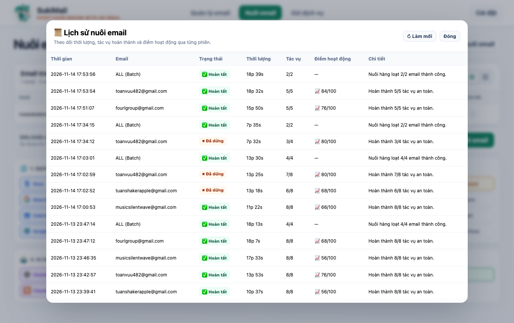
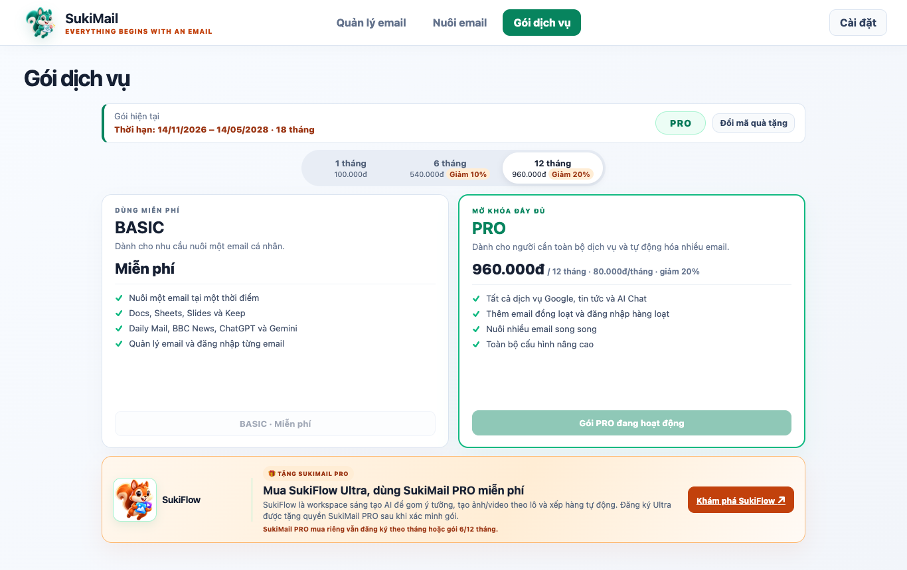
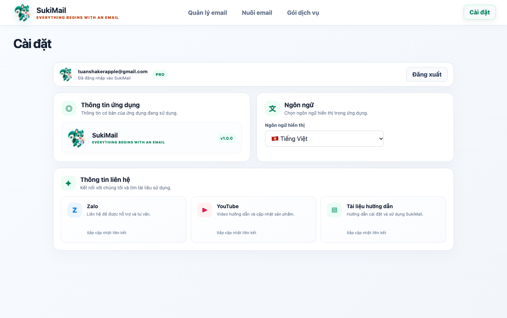

<p align="center">
  
</p>

<h1 align="center">SukiMail</h1>

<p align="center">
  <strong>Hệ Thống Quản Lý &amp; Nuôi Email Tự Động Hóa — EVERYTHING BEGINS WITH AN EMAIL</strong>
</p>

<p align="center">
  <a href="https://github.com/suki-app/sukimail-doc/releases/latest/download/SukiMail_Setup_v1.0.0.exe"></a>
  &nbsp;
  <a href="https://github.com/suki-app/sukimail-doc/releases/latest/download/SukiMail_macOS_v1.0.0_arm64.dmg"></a>
</p>

<p align="center">
  <a href="README_EN.md">English</a>
  ·
  <a href="https://github.com/suki-app/sukimail-doc/releases/latest">Phiên bản mới nhất</a>
  ·
  <a href="#4-hướng-dẫn-cài-đặt--khởi-động">Hướng dẫn cài đặt</a>
  ·
  <a href="#6-xử-lý-sự-cố-thường-gặp-troubleshooting">Khắc phục sự cố</a>
</p>

> Phiên bản hiện tại: **SukiMail 1.0.0**. SukiMail là ứng dụng desktop dành cho macOS và Windows. Giải pháp nuôi tài khoản Google / Gmail độc lập, an toàn và gia tăng độ tin cậy (Trust Score) tự nhiên bằng hành vi người dùng thật.

---

## 📖 Mục lục

- [1. Giới thiệu tổng quan](#1-giới-thiệu-tổng-quan)
- [2. Các tính năng nổi bật](#2-các-tính-năng-nổi-bật)
- [3. Yêu cầu hệ thống](#3-yêu-cầu-hệ-thống)
- [4. Hướng dẫn cài đặt & Khởi động](#4-hướng-dẫn-cài-đặt--khởi-động)
  - [Cách 1: Khởi động 1-click (Khuyên dùng trên macOS)](#cách-1-khởi-động-1-click-khuyên-dùng-trên-macos)
  - [Cách 2: Chạy thủ công từ Terminal / Dòng lệnh](#cách-2-chạy-thủ-công-từ-terminal--dòng-lệnh)
- [5. Hướng dẫn sử dụng chi tiết](#5-hướng-dẫn-sử-dụng-chi-tiết)
  - [5.1. Quản lý danh sách email](#51-quản-lý-danh-sách-email)
  - [5.2. Nhập email hàng loạt (Bulk Import)](#52-nhập-email-hàng-loạt-bulk-import)
  - [5.3. Trình nuôi email & Tăng độ Trust](#53-trình-nuôi-email--tăng-độ-trust)
  - [5.4. Chế độ nuôi hàng loạt & Tùy chọn giao diện List / Grid View](#54-chế-độ-nuôi-hàng-loạt--tùy-chọn-giao-diện-list--grid-view)
  - [5.5. Cấu hình hành vi & Thiết lập tự động](#55-cấu-hình-hành-vi--thiết-lập-tự-động)
  - [5.6. Lịch sử nuôi & Nhật ký chi tiết](#56-lịch-sử-nuôi--nhật-ký-chi-tiết)
  - [5.7. Gói dịch vụ & Cài đặt hệ thống](#57-gói-dịch-vụ--cài-đặt-hệ-thống)
- [6. Xử lý sự cố thường gặp (Troubleshooting)](#6-xử-lý-sự-cố-thường-gặp-troubleshooting)

---

## 1. Giới thiệu tổng quan

**SukiMail** là phần mềm desktop chuyên biệt cho việc nuôi dưỡng và quản lý số lượng lớn tài khoản Gmail. Điểm mấu chốt của SukiMail là **mỗi tài khoản email sở hữu một Chrome profile tách biệt hoàn toàn** (dữ liệu cookies, cache, lịch sử duyệt web riêng), kết hợp cùng động cơ tự động hóa giả lập thao tác người thật tự nhiên (Human-like behavior) nhằm vượt qua các thuật toán kiểm duyệt và hạn chế checkpoint của Google.

---

## 2. Các tính năng nổi bật

- 🛡️ **Chrome Profile Độc Lập:** Mỗi tài khoản được cấp một thư mục User Data riêng biệt, không bị rò rỉ dữ liệu chéo giữa các tài khoản.
- 🤖 **Giả Lập Hành Vi Tự Nhiên Đa Dạng:**
  - **Google Workspace:** Soạn thảo Google Docs, bảng tính Sheets, trình chiếu Slides, ghi chú Keep, Forms, Drive.
  - **Dịch Vụ Google Khác:** Google Search đọc kết quả, Google Maps tìm đường, Google News xem tin, Google Photos, Translate, Google Earth.
  - **Tin Tức Báo Chí:** BBC News, Daily Mail, CNN, TechCrunch, Medium, NatGeo... kèm cơ chế cuộn trang, dừng đọc bài và click đọc bài viết liên quan ngẫu nhiên.
  - **Trí Tuệ Nhân Tạo (AI Tools):** Tương tác với ChatGPT, Google Gemini, Claude, Grok, Perplexity, Copilot...
  - **Mạng Xã Hội:** YouTube, Instagram, TikTok, Reddit, X (Twitter), Quora.
- ⚡ **Nuôi Hàng Loạt Đa Luồng (Parallel Workers):** Hỗ trợ cấu hình số lượng worker chạy đồng thời tùy chỉnh theo cấu hình máy tính.
- 🎛️ **Chuyển Đổi Hiển Thị Linh Hoạt (List / Grid View):**
  - Tại màn hình nuôi email, người dùng có thể chuyển đổi nhanh chỉ với 1 click giữa giao diện **Danh sách bảng (Table/List)** và giao diện **Lưới thẻ (Grid View)** hiển thị 3–4 card mỗi hàng trực quan, đẹp mắt.
- 🎯 **Mục Tiêu & Lịch Nhắc Tự Động:** Theo dõi chu kỳ nuôi mục tiêu (ví dụ 60 ngày), nhắc nhở khi mở app hoặc theo khung giờ cố định/ngẫu nhiên.
- 📜 **Lịch Sử & Nhật Ký Realtime:** Terminal ghi nhận chi tiết từng bước click, cuộn trang, thời gian ở lại trang và chấm điểm hoạt động (Activity Score).
- 💳 **Thanh Toán Gói Dịch Vụ PRO VietQR:** Quét mã QR chuyển khoản tự động kích hoạt quyền lợi nâng cao.

---

## 3. Yêu cầu hệ thống

- **Hệ điều hành:** macOS 12 Monterey trở lên (Hỗ trợ cả Apple Silicon M1/M2/M3/M4 và Intel), Windows 10/11 hoặc Linux.
- **Trình duyệt:** Đã cài đặt **Google Chrome** chính thức tại `/Applications/Google Chrome.app`.
- **Python:** Phiên bản 3.10 trở lên.
- **Dung lượng trống:** Tối thiểu 2GB (để chứa các profile Chrome tách biệt).

---

## 4. Hướng dẫn cài đặt & Khởi động

### Cách 1: Khởi động 1-click (Khuyên dùng trên macOS)

Trong thư mục `App`, file thực thi đã được chuẩn bị sẵn:
1. Nhấp đúp vào file `Chay_SukiMail_macOS.command`.
2. Script sẽ tự động:
   - Kiểm tra và tạo môi trường ảo Python (`.venv`) nếu chưa có.
   - Cài đặt đầy đủ các thư viện phụ thuộc từ `requirements.txt`.
   - Khởi động backend FastAPI tại cổng `4751` và mở cửa sổ ứng dụng desktop native (`pywebview`).

> *Mẹo:* Nếu gặp thông báo bảo mật của macOS ("Unidentified developer"), chuột phải vào file `Chay_SukiMail_macOS.command` ➜ chọn **Open** ➜ nhấn **Open**.

---

### Cách 2: Chạy thủ công từ Terminal / Dòng lệnh

Nếu muốn chạy qua terminal hoặc tùy biến cấu hình:

```bash
# 1. Di chuyển vào thư mục ứng dụng
cd Documents/SukiMail/App

# 2. Tạo môi trường ảo và kích hoạt
python3 -m venv .venv
source .venv/bin/activate

# 3. Cài đặt các gói phụ thuộc
pip install -r requirements.txt

# 4. Khởi chạy ứng dụng Desktop
export SUKIMAIL_DATA_ROOT="$(dirname "$PWD")/Data"
python desktop_app.py
```

Ứng dụng cũng có thể truy cập trực tiếp qua trình duyệt web tại địa chỉ: `http://127.0.0.1:4751/sukimail`.

---

## 5. Hướng dẫn sử dụng chi tiết

### 5.1. Quản lý danh sách email

Tại tab **Quản lý email**, bạn có cái nhìn tổng quan về trạng thái của toàn bộ dàn tài khoản:
- Thống kê: Tổng email, Email còn hiệu lực, Đã đăng nhập, Đang chạy nuôi, Chờ thiết lập.
- Bảng danh sách email chi tiết: Avatar nhận diện, địa chỉ email, ghi chú, trạng thái hiệu lực, thời gian đã nuôi, lần nuôi gần nhất, trạng thái đăng nhập.
- Bộ lọc tìm kiếm nhanh theo email, số điện thoại, ghi chú.
- Sắp xếp linh hoạt theo Hiệu lực, Thời gian nuôi, Trạng thái đăng nhập.



Để thêm từng email: nhấn nút **＋ Thêm email** ở góc phải:
- Hỗ trợ nhập Email, Mật khẩu, Secret key 2FA, Email khôi phục, Số điện thoại, Kênh liên kết và Ghi chú.



---

### 5.2. Nhập email hàng loạt (Bulk Import)

Khi sở hữu danh sách nhiều tài khoản, nhấn nút **⬇ Thêm hàng loạt**:
- Hỗ trợ định dạng phân tách bằng dấu `|`:
  - `email | mật_khẩu | mã_2FA`
  - hoặc `email | mật_khẩu | số_điện_thoại | mã_2FA`
- Tích chọn **"Tự động đăng nhập và tạo Chrome profile riêng"** để ứng dụng tự động mở từng profile và đăng nhập sẵn sàng.



---

### 5.3. Trình nuôi email & Tăng độ Trust

Tab **Nuôi email** là trung tâm điều khiển và giám sát quá trình tự động hóa:
- **Thanh chọn email & Điều khiển đa luồng:** Chọn tài khoản cần kiểm tra, đăng nhập hoặc chạy đồng thời nhiều tài khoản song song.
- **Thước đo Trust & Hoạt động:** Điểm hoạt động ước tính (Trust Score), tiến độ mục tiêu, thời gian phiên, lượt tương tác Google Workspace, số bài báo đã đọc.
- **Bảng chọn hành vi (Bên trái):** Tùy chỉnh bật/tắt từng dịch vụ Google, trang tin tức, công cụ AI hoặc mạng xã hội.
- **Bảng điều khiển & Live Log (Bên phải):** Hiển thị tiến trình %, tác vụ hiện tại, thời gian dự kiến kết thúc và bảng nhật ký Terminal thời gian thực (hỗ trợ copy/xóa log).



---

### 5.4. Chế độ nuôi hàng loạt & Tùy chọn giao diện List / Grid View

Khi bạn tích chọn từ 1 đến 10 email ở màn Quản lý email rồi nhấn **⚡ Nuôi hàng loạt**, ứng dụng sẽ chuyển sang màn hình điều khiển lượt nuôi:
- **Hỗ trợ 2 chế độ hiển thị:** Người dùng có thể linh hoạt chuyển đổi giữa dạng **Danh sách bảng (List View)** và dạng **Lưới thẻ (Grid View)** chỉ với 1 click vào 2 icon chuyển đổi ở góc trên bảng nuôi.
- **Theo dõi đa luồng trực quan:** Hiển thị trực tiếp danh sách các tài khoản đang chạy song song, số worker đồng thời, tiến độ hoàn thành, tác vụ đang xử lý và thời lượng phiên.


---

### 5.5. Cấu hình hành vi & Thiết lập tự động

#### Cấu hình chung (Warmup Settings):
- Thiết lập **Số tác vụ mỗi phiên** (1–50 tác vụ).
- **Giãn cách ngẫu nhiên (delay):** Tránh bị phát hiện bot bằng cách nghỉ ngẫu nhiên giữa các thao tác.
- **Thời gian ở lại mỗi trang:** Giả lập thời gian đọc bài thực tế.
- **Tỷ lệ Click đọc tiếp bài viết liên quan:** Tự động điều hướng sang các liên kết hữu cơ.
- **Tùy chọn mở cửa sổ Chrome thật:** Cho phép xem trực tiếp quá trình bot thao tác hoặc ẩn ngầm.



#### Thiết lập tự động & Lịch nhắc:
- Đặt mục tiêu chu kỳ nuôi (ví dụ: nuôi ổn định trong 60 ngày).
- Bật thông báo nhắc nhở khi mở ứng dụng hoặc vào khung giờ cố định/ngẫu nhiên trong ngày.


---

### 5.6. Lịch sử nuôi & Nhật ký chi tiết

Bấm vào nút **Lịch sử nuôi email** để kiểm tra thống kê qua từng phiên chạy:
- Thời gian chạy, Email, Trạng thái (Hoàn tất / Đã dừng), Thời lượng phiên, Số tác vụ hoàn thành và Điểm hoạt động tích lũy.
- Nhấn vào icon chi tiết `ⓘ` ở từng phiên để mở popup xem chi tiết từng thao tác kèm mốc thời gian (timestamp).



---

### 5.7. Gói dịch vụ & Cài đặt hệ thống

#### Gói dịch vụ (BASIC & PRO):
- **Gói BASIC:** Miễn phí, nuôi 1 email tại một thời điểm với các dịch vụ cốt lõi.
- **Gói PRO:** Mở khóa toàn bộ dịch vụ nâng cao, nuôi nhiều email song song cùng lúc, nhập hàng loạt và hỗ trợ thanh toán VietQR tự động.
- **Linh hoạt thời hạn:** Dễ dàng chuyển đổi giữa các chu kỳ để nhận chiết khấu: **1 tháng (100.000đ)**, **6 tháng (540.000đ · Giảm 10%)** hoặc **12 tháng (960.000đ · Giảm 20%)**.

*Giao diện gói dịch vụ chu kỳ 1 tháng:*


*Giao diện khi chọn chu kỳ 6 tháng (giá tự động cập nhật giảm 10%):*


*Giao diện khi chọn chu kỳ 12 tháng (giá tự động cập nhật giảm 20%):*


#### Cài đặt:
- Xem thông tin tài khoản đang đăng nhập.
- Lựa chọn ngôn ngữ hiển thị: **Tiếng Việt 🇻🇳** hoặc **English 🇬🇧**.
- Các liên kết hỗ trợ và hướng dẫn người dùng.



---

## 6. Xử lý sự cố thường gặp (Troubleshooting)

### 1. Báo lỗi "Profile đang mở trong Chrome / Profile đang bị giữ"
- **Nguyên nhân:** Cửa sổ Chrome của profile email đó đang mở thủ công hoặc một phiên trước chưa đóng hẳn tiến trình.
- **Cách khắc phục:** Đóng các cửa sổ Google Chrome đang mở của email đó, hoặc nhấn nút **Thử lại** trên giao diện SukiMail để hệ thống tự động giải phóng lock file.

### 2. Không khởi động được script trên macOS
- Mở Terminal và cấp quyền thực thi cho file lệnh:
  ```bash
  chmod +x "/Users/macpro/Documents/SukiMail/App/Chay_SukiMail_macOS.command"
  ```

### 3. Cần làm mới trạng thái đăng nhập Google
- Nếu tài khoản bị đăng xuất hoặc đổi mật khẩu: tại tab **Nuôi email**, chọn email tương ứng và nhấn nút **🔑 Đăng nhập email**. Ứng dụng sẽ mở cửa sổ Chrome với đúng profile đó để bạn đăng nhập trực tiếp. Sau khi đăng nhập thành công, nhấn **🔍 Kiểm Tra** để SukiMail ghi nhận trạng thái mới.

---

<p align="center">
  <b>SukiMail</b> • Phát triển với mục tiêu bảo vệ và tối ưu độ tin cậy tài khoản số của bạn.
</p>

