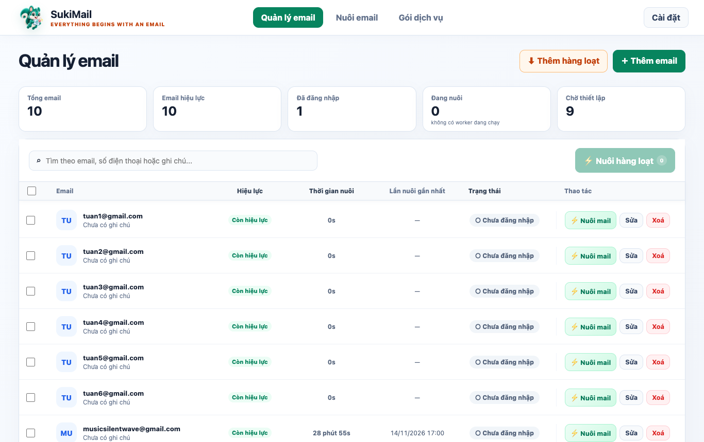
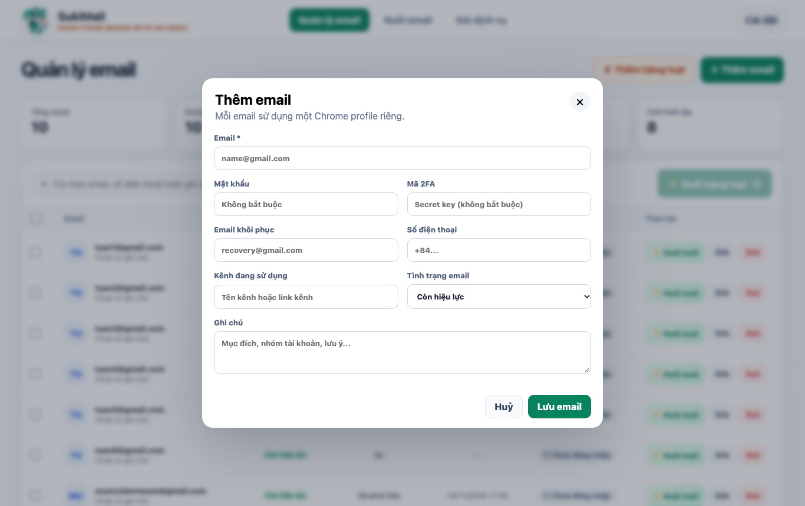
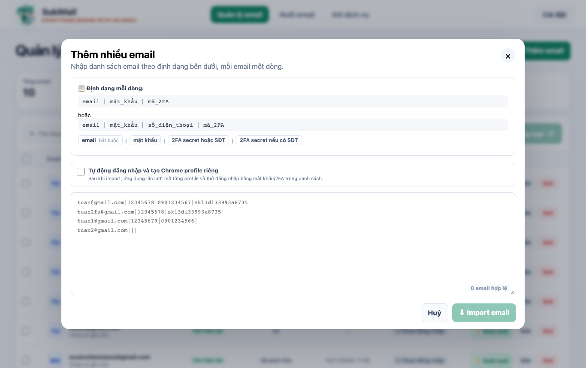
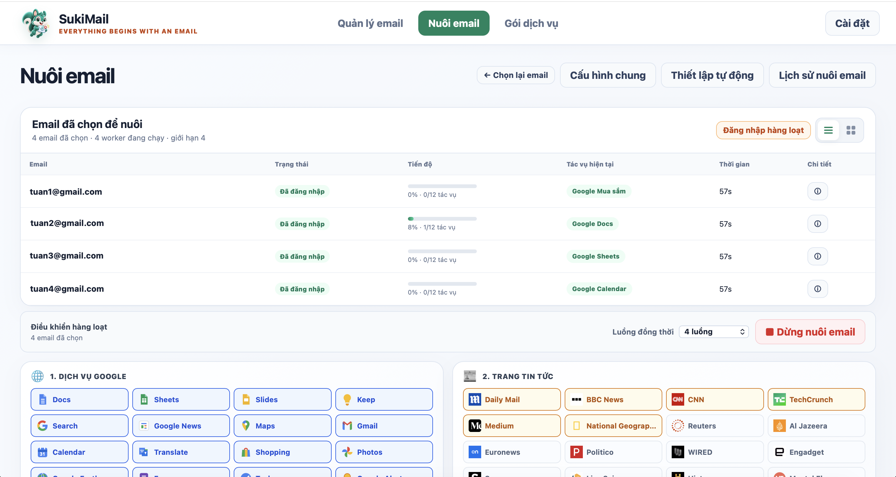
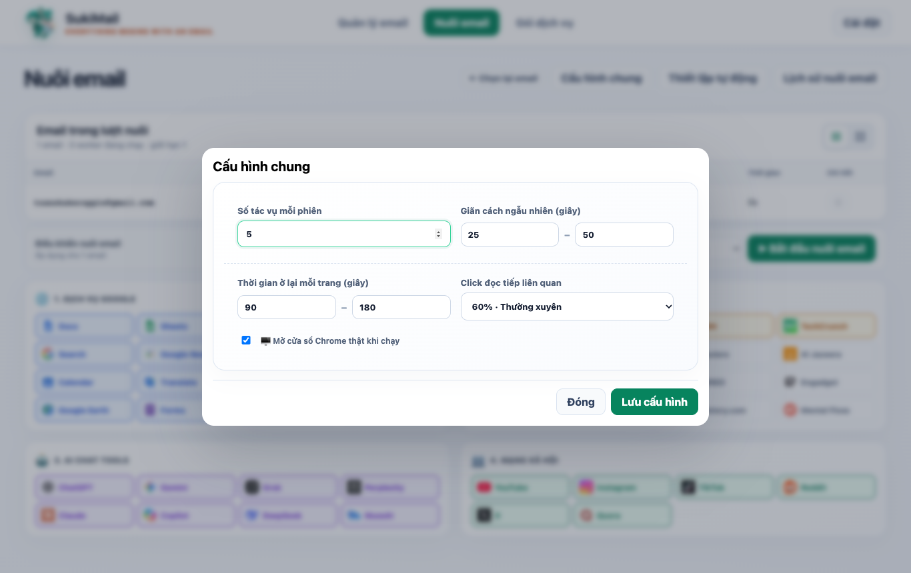
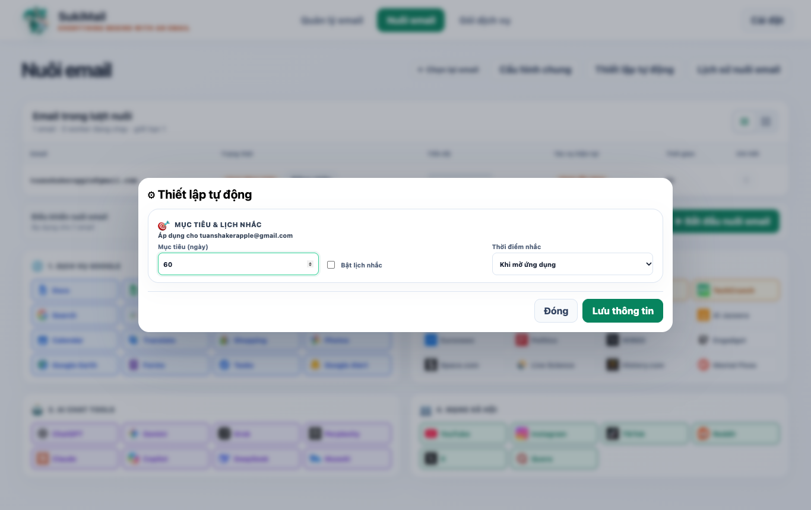
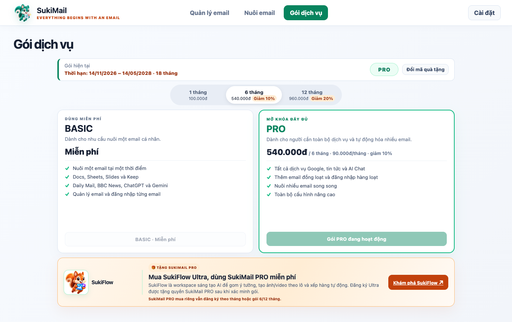
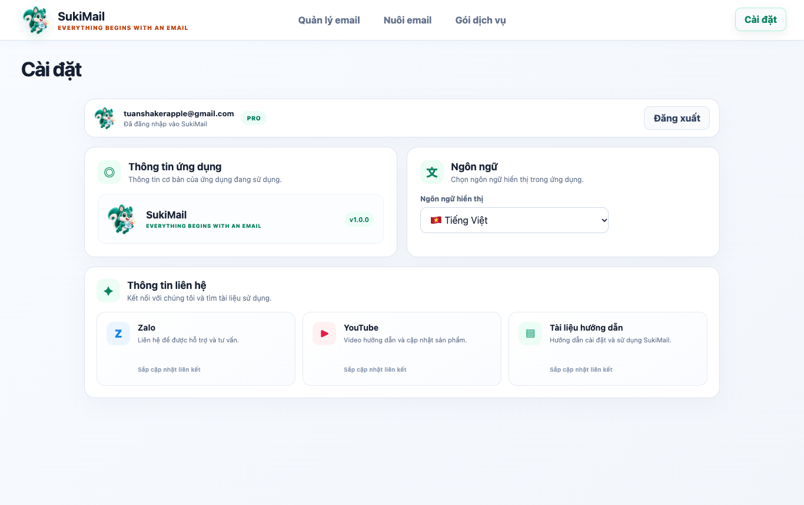

<p align="center">
  
</p>

<h1 align="center">SukiMail</h1>

<p align="center">
  <strong>Automated Email Management &amp; Warmup System — EVERYTHING BEGINS WITH AN EMAIL</strong>
</p>

<p align="center">
  <a href="https://github.com/suki-app/sukimail-doc/releases/latest/download/SukiMail_Setup_v1.0.0.exe"></a>
  &nbsp;
  <a href="https://github.com/suki-app/sukimail-doc/releases/latest/download/SukiMail_macOS_v1.0.0_arm64.dmg"></a>
</p>

<p align="center">
  <a href="README.md">Tiếng Việt</a>
  ·
  <a href="https://github.com/suki-app/sukimail-doc/releases/latest">Latest Release</a>
  ·
  <a href="#4-installation--quick-start">Installation</a>
  ·
  <a href="#6-troubleshooting">Troubleshooting</a>
</p>

> Current version: **SukiMail 1.0.0**. SukiMail is a desktop application for macOS and Windows. Dedicated to multi-account Google/Gmail warmup with isolated Chrome profiles and human-like engagement.

---

## 📖 Table of Contents

- [1. Overview](#1-overview)
- [2. Key Features](#2-key-features)
- [3. System Requirements](#3-system-requirements)
- [4. Installation & Getting Started](#4-installation--getting-started)
  - [Method 1: 1-Click Launch (Recommended for macOS)](#method-1-1-click-launch-recommended-for-macos)
  - [Method 2: Manual Launch via Terminal / CLI](#method-2-manual-launch-via-terminal--cli)
- [5. Detailed User Guide](#5-detailed-user-guide)
  - [5.1. Email Management](#51-email-management)
  - [5.2. Bulk Email Import](#52-bulk-email-import)
  - [5.3. Email Warmup & Trust Booster](#53-email-warmup--trust-booster)
  - [5.4. Batch Warmup & List / Grid View Switcher](#54-batch-warmup--list--grid-view-switcher)
  - [5.5. Behavior Settings & Automated Schedules](#55-behavior-settings--automated-schedules)
  - [5.6. Warmup History & Detailed Logs](#56-warmup-history--detailed-logs)
  - [5.7. Subscription Plans & System Settings](#57-subscription-plans--system-settings)
- [6. Troubleshooting](#6-troubleshooting)

---

## 1. Overview

**SukiMail** is a dedicated desktop application engineered for warming up and managing multiple Gmail accounts safely at scale. The cornerstone of SukiMail is that **each email account operates within an independent, isolated Chrome profile** (separate cookies, cache, storage, and browsing history). Coupled with a human-emulation engine, SukiMail mimics organic user interactions to establish strong account credibility and minimize Google checkpoints.

---

## 2. Key Features

- 🛡️ **Isolated Chrome Profiles:** Every account is assigned its own isolated Chrome profile directory, preventing cross-profile tracking and data leaks.
- 🤖 **Realistic Human Behavior Simulation:**
  - **Google Workspace:** Document drafting on Google Docs, spreadsheets on Sheets, presentations on Slides, note-taking on Keep, Forms, and Drive.
  - **Google Services:** Google Search with organic result reading, Google Maps navigation, Google News browsing, Photos, Translate, and Google Earth exploration.
  - **Trusted News Outlets:** Organic reading on BBC News, Daily Mail, CNN, TechCrunch, Medium, NatGeo... featuring randomized page scrolls, dwell time, and related article click-throughs.
  - **AI Chat Platforms:** Engages with ChatGPT, Google Gemini, Claude, Grok, Perplexity, Copilot...
  - **Social Media:** Explores YouTube, Instagram, TikTok, Reddit, X (Twitter), and Quora.
- ⚡ **Multi-threaded Batch Warmup (Parallel Workers):** Run concurrent warmup workers tailored to your system's hardware capability.
- 🎛️ **Flexible Display Modes (List / Grid View):**
  - In the Warmup tab, toggle seamlessly with a single click between **Table/List View** and an elegant **Grid View** displaying 3 to 4 responsive cards per row with status badges, progress metrics, and action buttons.
- 🎯 **Goals & Automated Reminders:** Set session targets (e.g., 60-day warmup cycles) with automated notifications on app launch or during scheduled time windows.
- 📜 **Real-time Logs & History:** In-app terminal displaying step-by-step actions, dwell duration, and estimated Activity Trust Scores.
- 💳 **VietQR Integrated Upgrades:** Quick subscription unlock via automated VietQR banking transfers.

---

## 3. System Requirements

- **Operating System:** macOS 12 Monterey or newer (Fully compatible with Apple Silicon M1/M2/M3/M4 & Intel), Windows 10/11, or Linux.
- **Browser:** Official **Google Chrome** installed at `/Applications/Google Chrome.app`.
- **Python:** Version 3.10 or higher.
- **Disk Space:** Minimum 2 GB free storage (to accommodate isolated Chrome profiles).

---

## 4. Installation & Getting Started

### Method 1: 1-Click Launch (Recommended for macOS)

In the `App` directory, a ready-to-run launcher script is provided:
1. Double-click `Chay_SukiMail_macOS.command`.
2. The script will automatically:
   - Create a Python virtual environment (`.venv`) if one does not exist.
   - Install all required dependencies from `requirements.txt`.
   - Start the local FastAPI server at port `4751` and present the native desktop window (`pywebview`).

> *Tip:* If macOS shows an "Unidentified developer" prompt, right-click `Chay_SukiMail_macOS.command` ➜ select **Open** ➜ click **Open**.

---

### Method 2: Manual Launch via Terminal / CLI

For command-line control or development:

```bash
# 1. Navigate to the application directory
cd Documents/SukiMail/App

# 2. Create and activate virtual environment
python3 -m venv .venv
source .venv/bin/activate

# 3. Install dependencies
pip install -r requirements.txt

# 4. Launch Desktop App
export SUKIMAIL_DATA_ROOT="$(dirname "$PWD")/Data"
python desktop_app.py
```

You can also access the application directly via any web browser at: `http://127.0.0.1:4751/sukimail`.

---

## 5. Detailed User Guide

### 5.1. Email Management

The **Email Management** tab offers a centralized dashboard to inspect your entire account inventory:
- Metrics: Total Emails, Valid Accounts, Signed-in Profiles, Active Warmup Workers, Pending Setup.
- Detailed Table: Account avatar, email address, custom notes, validity status, total warmup duration, last session date, and login state.
- Real-time search by email address, phone number, or notes.
- Quick sorting by Validity, Warmup Time, or Login Status.



To add accounts individually, click **＋ Thêm email** (Add Email) on the top right:
- Input Email, Password, 2FA Secret Key, Recovery Email, Phone Number, Linked Channel, and Notes.



---

### 5.2. Bulk Email Import

When onboarding a large list of accounts, click **⬇ Thêm hàng loạt** (Bulk Add):
- Supports pipe-delimited format (`|`):
  - `email | password | 2FA_secret`
  - or `email | password | phone_number | 2FA_secret`
- Check **"Tự động đăng nhập và tạo Chrome profile riêng"** to let the app automatically initialize Chrome profiles and sign in.



---

### 5.3. Email Warmup & Trust Booster

The **Email Warmup** tab is your mission control for automated engagement:
- **Account Selector & Multi-Worker Control:** Choose an account to inspect, authenticate, or run multiple parallel accounts concurrently.
- **Trust & Activity Metrics:** Estimated Activity Score (Trust Booster), Goal Progress, Current Session Duration, Workspace Interactions, Articles Read.
- **Behavior Matrix (Left):** Toggle specific Google services, news sites, AI platforms, or social media networks.
- **Control & Live Logs (Right):** Monitor percentage progress, active tasks, estimated completion time, and a real-time terminal with copy/clear controls.


---

### 5.4. Batch Warmup & List / Grid View Switcher

Select multiple active accounts (up to 10 per batch) on the Email Management screen and click **⚡ Nuôi hàng loạt** (Batch Warmup):
- **Flexible Display Modes:** Seamlessly toggle between **Table / List View** and **Card Grid View** with a single click on the view switcher icons on the toolbar.
- **Real-time Parallel Monitoring:** Track all concurrent worker threads side-by-side with live progress bars, active step indicators, and session durations.



---

### 5.5. Behavior Settings & Automated Schedules

#### General Warmup Settings:
- Configure **Tasks per Session** (1–50 tasks).
- **Randomized Delays:** Natural pause intervals between actions to mimic human pacing.
- **Page Dwell Time:** Realistic reading duration per article or web page.
- **Related Link Click-through Rate:** Frequency of browsing secondary related articles.
- **Show Real Chrome Window:** Toggle between watching the automation live or running silently.



#### Goals & Reminder Schedules:
- Set warmup day targets (e.g., a 60-day steady account maturation goal).
- Enable daily reminders on application launch or during specific timeframes.



---

### 5.6. Warmup History & Detailed Logs

Click **Lịch sử nuôi email** (Warmup History) to review all completed sessions:
- Timestamp, Email, Status (Done / Stopped), Duration, Tasks Completed, and Activity Score.
- Click the detail icon `ⓘ` on any entry to view chronological action logs.


---

### 5.7. Subscription Plans & System Settings

#### Plans (BASIC & PRO):
- **BASIC Plan:** Free tier, 1 concurrent account warmup with core services.
- **PRO Plan:** Unlocks all advanced services, multi-account parallel workers, bulk operations, and VietQR instant activation.
- **Flexible Billing Cycles:** Seamlessly toggle between billing terms for discounts: **1 Month (100,000 VND)**, **6 Months (540,000 VND · Save 10%)**, or **12 Months (960,000 VND · Save 20%)**.

*1-Month Plan Billing View:*


*6-Month Plan Billing View (10% discount):*


*12-Month Plan Billing View (20% discount):*


#### Settings:
- View active signed-in user credentials.
- Switch display language: **Tiếng Việt 🇻🇳** or **English 🇬🇧**.
- Support resources and documentation links.



---

## 6. Troubleshooting

### 1. "Profile đang mở trong Chrome / Profile đang bị giữ" (Profile is locked)
- **Cause:** The Google Chrome window for that email profile is still open, or a previous process did not exit cleanly.
- **Solution:** Close any Google Chrome windows running that account, or click the **Thử lại** (Retry) button in SukiMail to automatically clear the lock file.

### 2. Launch script permission error on macOS
- Open Terminal and grant execute permissions:
  ```bash
  chmod +x "/Users/macpro/Documents/SukiMail/App/Chay_SukiMail_macOS.command"
  ```

### 3. Re-authenticating a Google Account
- If Google requests password re-entry or 2FA verification: navigate to the **Nuôi email** (Warmup) tab, select the account, and click **🔑 Đăng nhập email**. SukiMail will open the exact Chrome profile for you to complete sign-in manually. Once finished, click **🔍 Kiểm Tra** (Check) to update the login status.

---

<p align="center">
  <b>SukiMail</b> • Built to protect, nurture, and maximize your digital account trust.
</p>
