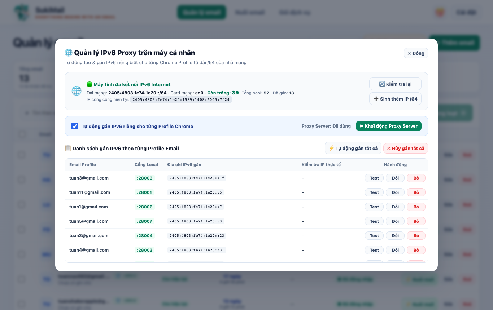
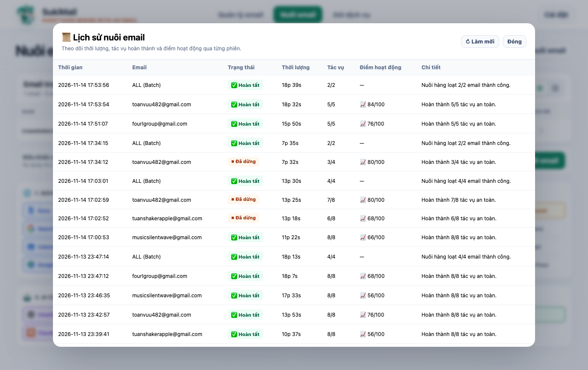
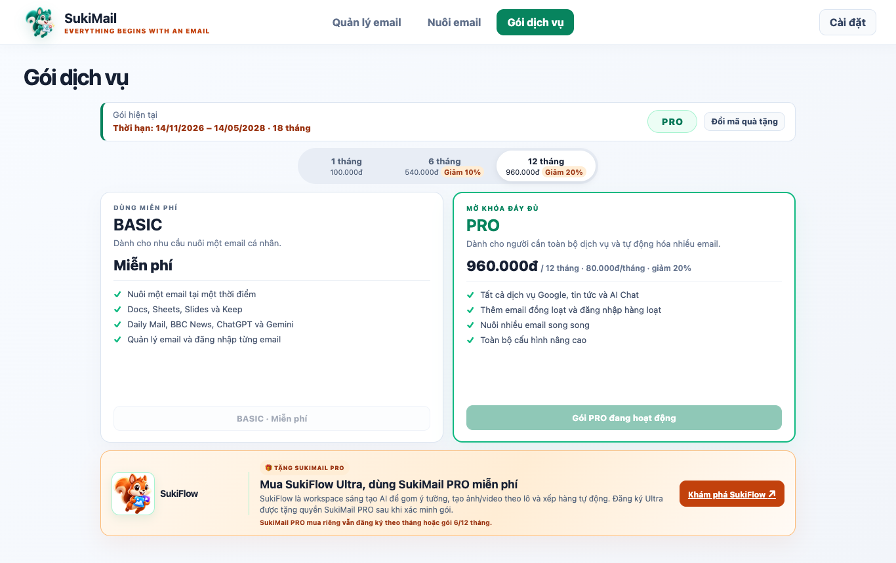
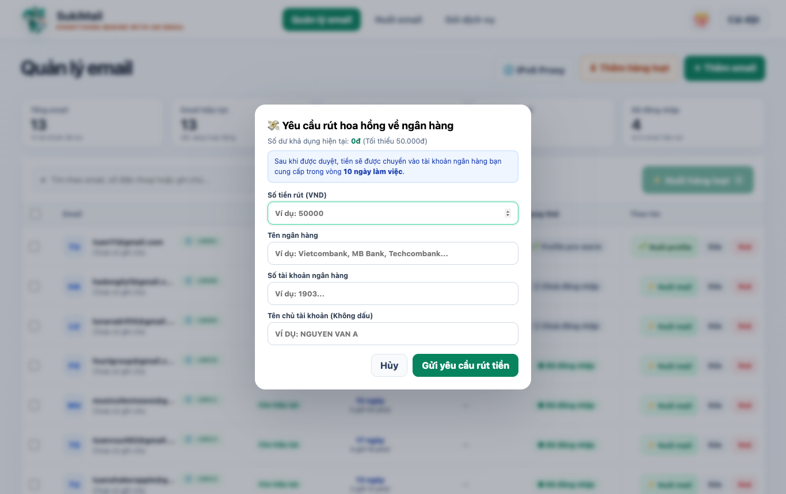

  

<h1 align="center">SukiMail</h1>

  <strong>Automated Email Management &amp; Warmup System — EVERYTHING BEGINS WITH AN EMAIL</strong>

  
  &nbsp;
  

  <a href="README.md">Tiếng Việt</a>
  ·
  <a href="https://github.com/suki-app/sukimail-doc/releases/latest">Latest Release</a>
  ·
  <a href="#4-installation--getting-started">Installation</a>
  ·
  <a href="#6-troubleshooting">Troubleshooting</a>

> Current version: **SukiMail 1.0.0**. SukiMail is a desktop application for macOS and Windows. Dedicated to multi-account Google/Gmail warmup with isolated Chrome profiles, dedicated Local IPv6 Proxy Engine, and organic human-like engagement.

---

## 📖 Table of Contents

- [1. Overview](#1-overview)
- [2. Key Features](#2-key-features)
- [3. System Requirements](#3-system-requirements)
- [4. Installation & Getting Started](#4-installation--getting-started)
- [5. Detailed User Guide](#5-detailed-user-guide)
  - [5.1. Email Management](#51-email-management)
  - [5.2. Bulk Email Import](#52-bulk-email-import)
  - [5.3. Local IPv6 Proxy Engine (/64)](#53-local-ipv6-proxy-engine-64)
  - [5.4. Email Warmup & Trust Booster](#54-email-warmup--trust-booster)
  - [5.5. Batch Warmup & List / Grid View Modes](#55-batch-warmup--list--grid-view-modes)
  - [5.6. Behavior Settings & History Pre-warming](#56-behavior-settings--history-pre-warming)
  - [5.7. Warmup History & Real-time Logs](#57-warmup-history--real-time-logs)
  - [5.8. Subscription Plans & Automated VietQR Checkout](#58-subscription-plans--automated-vietqr-checkout)
  - [5.9. Referral Program & Affiliate Commission](#59-referral-program--affiliate-commission)
  - [5.10. Settings & Language Switch](#510-settings--language-switch)
- [6. Troubleshooting](#6-troubleshooting)

---

## 1. Overview

**SukiMail** is a dedicated desktop application engineered for warming up and managing multiple Gmail accounts safely at scale. The cornerstone of SukiMail is that **each email account operates within an independent, isolated Chrome profile** (separate cookies, cache, storage, and browsing history). Coupled with a human-emulation engine, SukiMail mimics organic user interactions to establish strong account credibility and minimize Google checkpoints.

Furthermore, SukiMail integrates a **Local IPv6 Proxy Engine**, tapping into your ISP's free `/64` subnet to assign each profile a unique public IPv6 address, eliminating cross-profile fingerprinting and account link flags.

---

## 2. Key Features

- 🛡️ **Isolated Chrome Profiles:** Every account is assigned its own isolated Chrome profile directory, preventing cross-profile tracking and data leaks.
- 🌐 **Local IPv6 Proxy Engine (/64):**
  - Automatically identifies local IPv6 connectivity and the `/64` subnet prefix.
  - Generates 1-click native scripts to bind dozens or hundreds of free IPv6 aliases to your network interface.
  - Dynamically routes each profile through a local port (`127.0.0.1:280xx`) backed by a dedicated IPv6.
  - Comprehensive actions: **Test IP**, **Reassign Port & IP**, and **Unassign** back to direct network.
  - Strict pool protection: Prevents assigning duplicates when the pool is exhausted to ensure **1 Profile = 1 Dedicated IPv6**.
- 🌱 **History Pre-warming (Profile Seeding):**
  - Pre-warms fresh accounts over 3 to 30 days to build up natural cookies, cache, and search histories before active tasks.
- 🤖 **Realistic Human Behavior Simulation:**
  - **Google Workspace:** Document drafting on Google Docs, spreadsheets on Sheets, presentations on Slides, note-taking on Keep, Forms, and Drive.
  - **Google Services:** Google Search with organic result reading, Google Maps navigation, Google News browsing, Photos, Translate, and Google Earth exploration.
  - **Trusted News Outlets:** Organic reading on BBC News, Daily Mail, CNN, TechCrunch, Medium, NatGeo... featuring randomized page scrolls, dwell time, and related article click-throughs.
  - **AI Chat Platforms:** Engages with ChatGPT, Google Gemini, Claude, Grok, Perplexity, Copilot...
  - **Social Media:** Explores YouTube, Instagram, TikTok, Reddit, X (Twitter), and Quora.
- ⚡ **Multi-threaded Batch Warmup (Parallel Workers):** Run concurrent warmup workers tailored to your system's hardware capability.
- 🎛️ **Flexible Display Modes (List / Grid View):**
  - Toggle between **Table/List View** and a responsive **Grid View** with visual cards displaying progress and current actions.
- 🎯 **Goals & Automated Reminders:** Set session targets (e.g., 60-day warmup cycles) with automated notifications.
- 📜 **Real-time Logs & History:** In-app terminal displaying step-by-step actions, dwell duration, and estimated Activity Trust Scores.
- 💳 **Automated VietQR Checkout:** 1-click instant PRO unlock via banking QR with flexible 1-month, 6-month (-10%), and 12-month (-20%) plans.
- 🎁 **Referral & Affiliate Program:**
  - Earn **20% cash commission** on every PRO purchase made by users you refer.
  - Invited users receive **+1 bonus month of PRO** upon checkout.
  - Withdraw commissions directly to Vietnamese bank accounts or convert to PRO days.

---

## 3. System Requirements

- **Operating System:** macOS 12 Monterey or newer (Apple Silicon & Intel), Windows 10/11 (64-bit).
- **Browser:** Official **Google Chrome** installed on the host machine.
- **Disk Space:** Minimum 2 GB free storage (for isolated Chrome profiles and user data).

---

## 4. Installation & Getting Started

- **macOS:** Download `SukiMail.dmg`, open it, and **drag the SukiMail icon into Applications**. Open SukiMail from Launchpad. All runtime binaries and Python dependencies are pre-bundled.
- **Windows:** Download `SukiMail_Setup.exe` and follow the setup wizard.

---

## 5. Detailed User Guide

### 5.1. Email Management

Overview of your accounts in the **Email Management** tab:
- Aggregate metrics: Total emails, Valid accounts, Logged in, Currently warming, Pending setup.
- Detailed table: Avatar, email address, notes, status, warmup duration, last active, login state.
- **IPv6 Proxy Badge (`🌐 :port`):** Displays assigned local proxy port for each profile.

Add individual emails using the **＋ Add Email** button:
- Supports Email, Password, 2FA Secret Key, Recovery Email, Phone, Channel, and Notes.

---

### 5.2. Bulk Email Import

Import accounts in bulk via the **⬇ Bulk Import** button:
- Supports pipe-delimited format:
  - `email | password | 2fa_secret`
  - or `email | password | phone | 2fa_secret`
- Optional auto-login and Chrome profile initialization on import.

---

### 5.3. Local IPv6 Proxy Engine (/64)

Open the **🌐 IPv6 Proxy** dialog:
- **Network Status:** Displays detected `/64` prefix, active interface, public IP, and IP pool breakdown (`52 IPs (Free: 49 · Assigned: 3)`).
- **Proxy Server Controls:** 1-click start/stop for the local proxy engine.
- **Per-Profile Actions:**
  - **`Test`**: Verifies connectivity and identifies the outgoing public IPv6.
  - **`Đổi (Reassign)`**: Rotates to a new local port and allocates another free IPv6.
  - **`Bỏ (Unassign)`**: Reverts the profile to direct network connection.
- **Strict Pool Enforcement:** Blocks assignments when the pool is fully occupied, enforcing **1 Profile = 1 Unique IPv6**.

To expand the IPv6 pool, click **➕ Generate IPv6 /64**:
- Generates native command scripts to bind 50 to 500 IPv6 aliases instantly.

---

### 5.4. Email Warmup & Trust Booster

The **Warmup** tab provides complete oversight of automation runs:
- **Account Selector & Parallel Controls:** Choose target profiles or launch multi-worker runs.
- **Trust & Activity Gauges:** Estimated Trust Score, cycle progress, session duration, and interaction counters.
- **Behavior Checklist (Left):** Toggle individual Google services, news portals, AI tools, or social media.
- **Terminal & Live Log (Right):** Real-time command stream with copy and clear log actions.

---

### 5.5. Batch Warmup & List / Grid View Modes

Select multiple accounts and click **⚡ Batch Warmup**:
- **Dual Display Modes:** Switch between **List View** and **Grid View** with a single click.
- **Multi-worker Monitoring:** Real-time visibility into parallel worker processes, progress bars, active steps, and session timers.

---

### 5.6. Behavior Settings & History Pre-warming

#### Warmup Settings:
- Configure **tasks per session** (1–50 tasks), random dwell delays, and related article click probabilities.
- Choose between headful (visible Chrome window) or background headless operation.

#### History Pre-warming (Profile Seeding):
- Enable **History Pre-warming** to simulate 3–30 days of natural browsing history and cookie accumulation before main tasks.
- Schedule automatic session reminders.

---

### 5.7. Warmup History & Real-time Logs

Review historical performance via the **Warmup History** dialog:
- Session timestamps, duration, task counts, and earned Activity Scores.
- Click `ⓘ` to inspect detailed step logs with timestamps.

---

### 5.8. Subscription Plans & Automated VietQR Checkout

#### Subscription Plans:
- **BASIC Plan:** Free, 1 email at a time with core Google apps.
- **PRO Plan:** Unlocks parallel multi-worker warmup, full IPv6 proxy engine, bulk import, and priority features.
  - **1 Month:** 100,000 VND
  - **6 Months:** 540,000 VND *(Save 10%)*
  - **12 Months:** 960,000 VND *(Save 20%)*

*1-Month Plan:*

*6-Month Plan (10% Discount):*

*12-Month Plan (20% Discount):*

#### Automated VietQR Payment:
- Click **Upgrade to PRO** to generate an instant banking QR code with auto-populated reference codes.
- Apply referral codes for **+1 bonus month of PRO**.
- Instant activation within 5–10 seconds after bank transfer completion.

---

### 5.9. Referral Program & Affiliate Commission

Click the gift icon 🎁 or **Referral Program** in the Plans tab:
- **Custom Referral Code:** Share your exclusive referral code with friends and colleagues.
- **20% Cash Commission:** Receive 20% on every PRO renewal made through your link.
- **Bonus for Referees:** Invited users receive **+1 free month of PRO**.
- Comprehensive stats tracking total referrals, sales volume, and withdrawable balance.

#### Withdrawals & PRO Redemptions:
- **Bank Transfer:** Withdraw earnings (minimum 100,000 VND) directly to any Vietnamese bank account.
- **Convert to PRO:** Redeem affiliate commissions directly into PRO membership days.

---

### 5.10. Settings & Language Switch

Under the **Settings** tab:
- Check current user login and license tier.
- Switch interface language between **Tiếng Việt 🇻🇳** and **English 🇬🇧**.
- View software version, documentation, and technical support links.

---

## 6. Troubleshooting

### 1. "Profile already open in Chrome / Lock file active"
- **Cause:** A Chrome window for that profile is already running or a previous process did not release its lock.
- **Fix:** Close any open Chrome windows for that profile, or click **Retry** in SukiMail to release the lock file automatically.

### 2. "Proxy server is not running" error
- **Cause:** The local proxy engine is stopped.
- **Fix:** Open the IPv6 Proxy dialog and click **▶ Start Proxy Server**. Once the badge turns green (*Proxy Server: Running*), proceed with testing or assigning.

### 3. "All available IPv6 addresses in Pool are assigned"
- **Cause:** Every IP in the pool has been assigned to an active profile (enforcing 1 Profile = 1 IPv6).
- **Fix:** Click **➕ Generate IPv6 /64**, select the number of aliases (e.g., 50 or 100), and run the script to expand your IP pool.

---

  <b>SukiMail</b> • Leading automated email management &amp; trust booster • Everything begins with an email.

